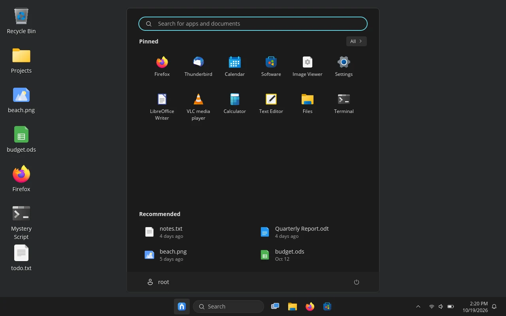

<p align="center">
  
</p>

<h1 align="center">Lapin UX</h1>

<p align="center"><b>A Linux desktop you already know how to use.</b></p>

<p align="center">
  <a href="LICENSE"></a>
  
  
  
</p>

<p align="center">
  <a href="#quick-start">Quick start</a> ·
  <a href="docs/SCREENSHOTS.md">Screenshots</a> ·
  <a href="docs/ROADMAP.md">Roadmap</a> ·
  <a href="https://github.com/znraznra/lapin-ux/wiki">Wiki</a> ·
  <a href="CONTRIBUTING.md">Contribute</a>
</p>

Lapin UX is built so there is nothing to learn: the taskbar, Start menu with search, quick settings, notifications, snap layouts, Task Manager, Control Panel and the keyboard shortcuts are where your hands and eyes expect them. No plugins to hunt down, no terminal needed for everyday tasks. Written in Rust on top of [COSMIC](https://github.com/pop-os/cosmic-epoch). Arch Linux first.



> **Preview.** The everyday desktop and the Settings app are built. The first real-PC test (CachyOS) installed fine; the [bugs it found](https://github.com/znraznra/lapin-ux/issues) are fixed and waiting for a retest. Still to come: File Explorer, a Store and a snip markup editor.

## Features

- **Where things are.** Taskbar along the bottom, Start in the centre, quick settings and the clock at the right.
- **How things behave.** Click to open or minimise, right-click for recent files, drag to snap, Alt+Tab with live thumbnails.
- **Keys you already know.** Alt+Tab, Alt+F4, Ctrl+Shift+Esc, Ctrl+Alt+Del and the Super key shortcuts.
- **No setup chores.** One installer, everyday tasks in Settings instead of config files.
- **Safe to try.** It lives next to your other desktops and puts everything back when you remove it.

[See it in screenshots →](docs/SCREENSHOTS.md)

## Quick start

You need Arch Linux or an Arch-based distribution (CachyOS is the first one tested) and a Wayland-capable graphics setup. `sh tools/preflight.sh` checks your machine and changes nothing.

```sh
git clone https://github.com/znraznra/lapin-ux.git
cd lapin-ux
./install.sh
```

Log out, pick **Lapin UX** on the sign-in screen, and sign in. The first build takes 10 to 20 minutes.

- **Just looking?** [Run it in a window](docs/TECHNICAL.md#try-it-without-installing), nothing installed.
- **Want it gone?** Run `lapin-ux-uninstall`. It puts everything back. [Details](docs/UNINSTALL.md).
- **Something broke?** The [test checklist](TESTING.md) says what to check, then [open an issue](https://github.com/znraznra/lapin-ux/issues).

## Keyboard shortcuts

| Keys | What happens |
|---|---|
| Super | Start |
| Super + E / D / L | Files / show the desktop / lock |
| Super + A / N | Quick settings / notifications |
| Super + Z | Snap layouts |
| Alt + Tab | Switch windows |
| Ctrl + Shift + Esc | Task Manager |

Full list in the [technical reference](docs/TECHNICAL.md).

## Progress

| Phase | What it covers | Progress |
|---|---|---|
| 1. Core desktop | Taskbar, Start, notifications, tray, wallpaper and theme | `██████████` 12 of 12 |
| 2. Settings and multitasking | Settings, quick settings, notification centre, Alt+Tab, Task view, snapping | `██████████` 9 of 9 |
| 3. System apps | File Explorer, Update, Control Panel | `███████░░░` 4 of 6, 1 partly |
| 4. Zero learning curve | Lock and sign-in, Task Manager, snipping, touch keyboard, accessibility, sounds… | `████████░░` 15 of 19, 2 partly |

*Last updated: 2 November 2026 (progress figures as of build `8326c84`).*

[Full roadmap, phase by phase →](docs/ROADMAP.md)

## Documentation

| | |
|---|---|
| [Screenshots](docs/SCREENSHOTS.md) | The desktop and the Settings app |
| [Roadmap](docs/ROADMAP.md) | What's done, what's next, what's not planned |
| [How it fits together](docs/ARCHITECTURE.md) | The parts and how they connect |
| [Technical reference](docs/TECHNICAL.md) | Building, testing, settings, every part in detail |
| [Test checklist](TESTING.md) | How to try it and what to check |
| [Uninstall](docs/UNINSTALL.md) | What it removes and puts back |
| [Wiki](https://github.com/znraznra/lapin-ux/wiki) | Feature set, challenges, design decisions, white paper |

## Get involved

- **Help:** testing on your own hardware is as valuable as code. See [CONTRIBUTING.md](CONTRIBUTING.md) and the [Code of Conduct](CODE_OF_CONDUCT.md).
- **Ask:** [Discussions](https://github.com/znraznra/lapin-ux/discussions) for questions and ideas, [Issues](https://github.com/znraznra/lapin-ux/issues) for bugs and requests.
- **Security:** please don't post problems publicly. Follow the [Security Policy](SECURITY.md).

## License

Lapin UX's own code and original artwork (logo, wallpapers) are GPL-3.0-only. Window tracking, the tray watcher and menus, and the session start script are adapted from System76's GPL-3.0 COSMIC projects; see file headers.

Third-party fonts, icons, emoji and sounds, the optional mouse pointers and all trademark notices are in [CREDITS.md](CREDITS.md). Lapin UX ships no Microsoft logos, artwork or proprietary fonts, and is an independent project, not affiliated with or endorsed by Microsoft, Canonical or System76.
