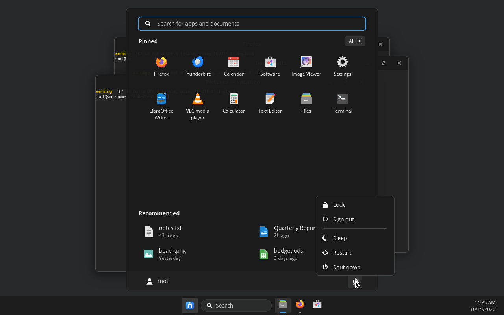
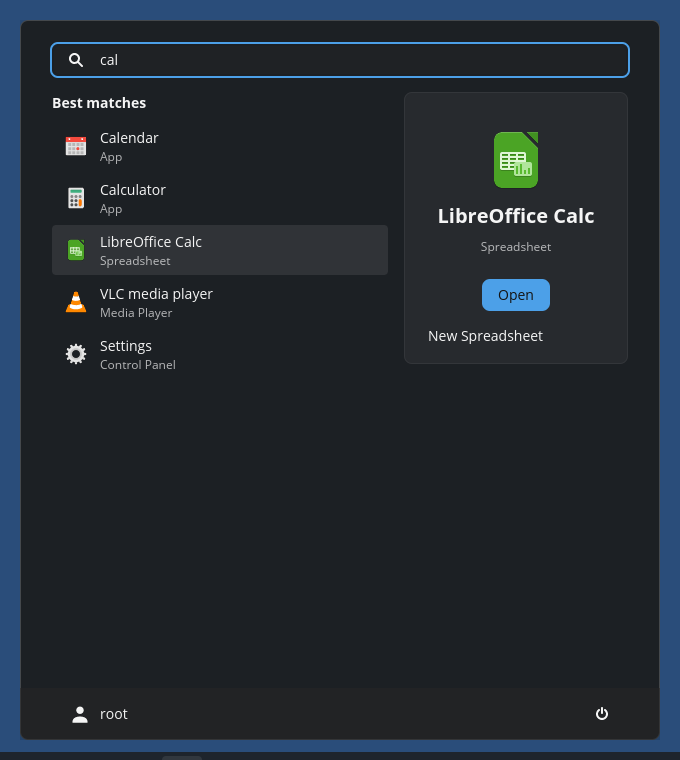
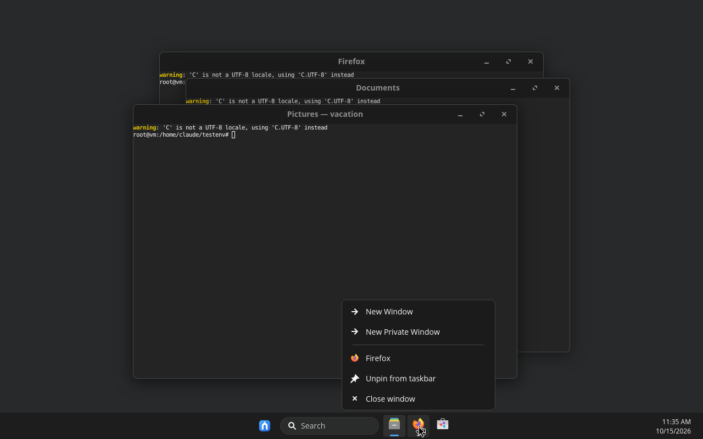
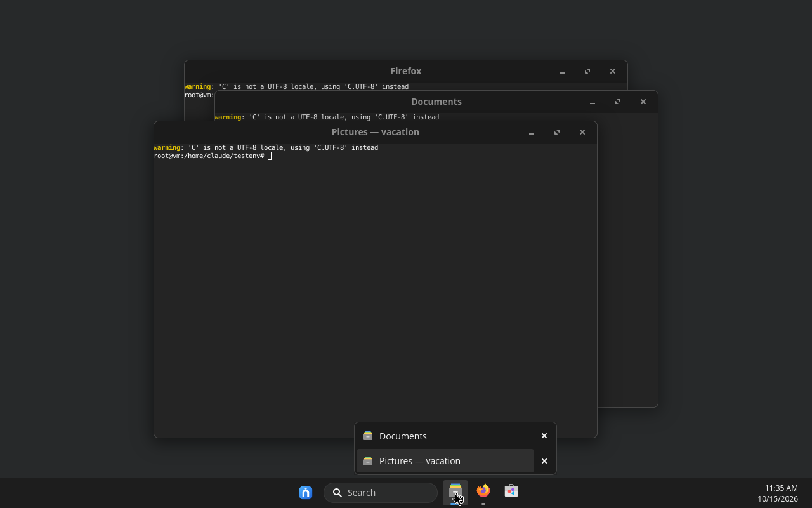
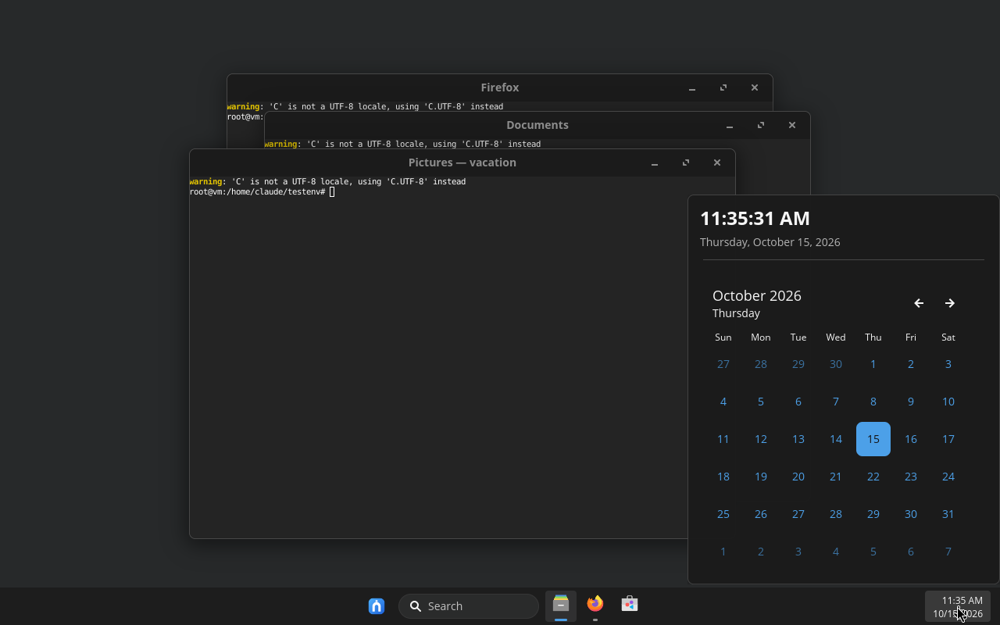
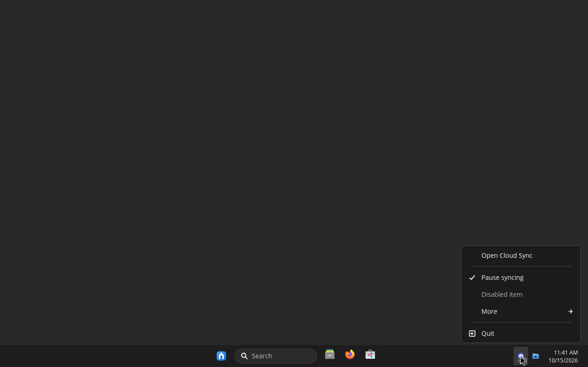
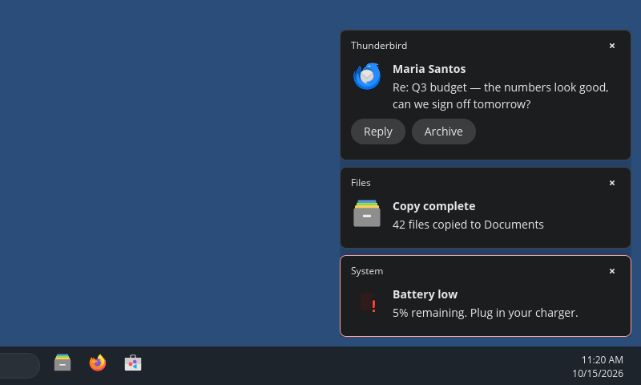

# Lapin UX

A Linux desktop that feels familiar to anyone coming from Windows 11: a
centered taskbar, a Start menu with search, pinned apps and recent files,
toasts in the bottom-right corner, a system tray, and the keyboard shortcuts
people already know. Written in Rust with [libcosmic]/iced, running on the
COSMIC compositor. Arch Linux first.

> Lapin UX matches *behaviour, layout and feel*. It contains no Microsoft
> artwork, fonts, names or logos; the Start mark, wallpapers and icons in
> `data/` are original.

| | |
|---|---|
|  |  |
|  |  |
|  |  |



## What's in the box (phase 1)

**Taskbar** (`lapin-ux-shell`), one per monitor
- Centered (or left-aligned) Start button, Search box, pinned and running apps.
- All windows of an app share a button. Click: open / focus / minimize;
  several windows: a window picker. Middle-click: new instance.
- Accent "pill" under the focused app, short dash for background apps.
- Right-click: the app's own jump-list actions (e.g. *New Private Window*),
  pin/unpin, close window(s).
- System tray (StatusNotifierItem): left-click activates, right-click opens
  the app's menu with checkmarks, disabled items and submenus. Discord,
  Steam, Nextcloud, etc. show up here.
- Clock with locale-aware time/date; click for a calendar.
- "Show desktop" sliver at the far right (click again to restore).

**Start menu**
- Type immediately to search. Ranking favours exact and prefix matches,
  initials (`vsc` → Visual Studio Code), generic names (`browser`), keywords
  and executables (`nautilus` → Files). Arrow keys + Enter work; Esc steps back.
- Pinned grid (6 × 3), *All apps* with A–Z sections, *Recommended* from recently
  opened files (`recently-used.xbel`) or recently launched apps.
- Right-click any app: pin/unpin to Start or taskbar.
- Account name/avatar, and a power menu: Lock, Sign out, Sleep, Restart, Shut down.

**Notifications** (`lapin-ux-notifyd`)
- Full `org.freedesktop.Notifications` server: actions, urgency, replace-id,
  transient, image-path, markup stripped to plain text.
- Up to 3 toasts stacked above the taskbar, 5 s default, critical ones stay,
  hover pauses the timer, Do-not-disturb ready in the queue logic.

**Session** (`lapin-ux-session`, `start-lapin-ux`)
- Starts cosmic-comp in normal (not kiosk) mode using the same handshake as
  cosmic-session, exports the display to systemd/D-Bus, then starts and
  supervises every component with exponential back-off restarts.
- `dev.lapinux.Session.Exit` on the session bus for Sign out.
- XDG autostart ("startup apps") through `lapin-ux-session.target`.

**First-run defaults** (written once; your later changes are never overwritten)
- Theme: blue accent, 4 px control / 8 px window corners, frosted shell surfaces.
- Font: Inter for the whole interface (if you haven't already picked a font).
- Wallpaper: original light/dark artwork.
- Keyboard: Super opens Start, plus

| Keys | Action |
|---|---|
| Super | Start menu |
| Super + E | File manager |
| Super + D | Show desktop / restore |
| Super + L | Lock |
| Super + ↑ / ↓ | Maximize / minimize |
| Super + Shift + S | Screenshot |
| Alt + Tab | Switch windows |
| Ctrl + Alt + Del | Sign-out / power dialog |

## Architecture

```
display manager ──> start-lapin-ux ──> lapin-ux-session
                                      ├─ cosmic-comp            compositor (reused, unmodified)
                                      ├─ lapin-ux-shell           taskbar ×N, Start menu, tray   ← ours
                                      ├─ lapin-ux-notifyd         notification toasts            ← ours
                                      ├─ cosmic-settings-daemon theme, media keys              (reused)
                                      ├─ cosmic-bg              wallpaper                      (reused)
                                      ├─ cosmic-osd             volume OSD, polkit dialogs     (reused)
                                      ├─ cosmic-idle            screen blanking                (reused)
                                      └─ cosmic-greeter         lock screen                    (reused)
```

| Crate | What it is | Depends on libcosmic |
|---|---|---|
| `lapin-ux-core` | Search ranking, taskbar model, toast queue, clock formats, recent files. 36 unit tests. | no |
| `lapin-ux-shell` | Taskbar, Start menu, tray, popups, first-run defaults | yes |
| `lapin-ux-notifyd` | Notification server and toasts | yes |
| `lapin-ux-session` | Compositor handshake and process supervisor. 2 tests. | no |

Window tracking supports two backends: cosmic-comp's protocols (full
control) and `wlr-foreign-toplevel-management` (sway, Hyprland, labwc,
niri…), so the shell also runs on wlroots compositors.

All settings use cosmic-config and apply live:
`~/.config/cosmic/dev.lapinux.Shell/v1/` (`pinned_taskbar`, `pinned_start`,
`alignment` = `Center`/`Left`, `show_search`, `clock_24h`, `clock_seconds`,
`show_desktop_corner`).

## Install on Arch

```sh
sudo pacman -S --needed base-devel rust python-numpy python-pillow \
    cosmic-comp cosmic-settings-daemon cosmic-bg cosmic-osd cosmic-idle cosmic-greeter \
    cosmic-launcher cosmic-screenshot cosmic-icon-theme xdg-desktop-portal-cosmic inter-font
cd packaging/arch
makepkg -si
```

Log out, pick **Lapin UX** in your display manager's session list, log in.
Uninstall with `sudo pacman -R lapin-ux-desktop-git`.

## Try it without installing

From a terminal inside any Wayland session (COSMIC, GNOME, KDE, sway…) with
`cosmic-comp` installed:

```sh
cargo build
PATH="$PWD/target/debug:$PATH" XDG_CURRENT_DESKTOP=LapinUX:COSMIC target/debug/lapin-ux-session
```

cosmic-comp detects the parent session and opens as a window containing a
full Lapin UX desktop. Close the window (or `pkill lapin-ux-session`) to stop.

## Develop

```sh
cargo test --workspace     # unit tests (core logic, session handshake)
cargo clippy --workspace   # clean at the time of writing
RUST_LOG=lapin_ux_shell=debug target/debug/lapin-ux-shell   # run the shell alone in a session
target/debug/lapin-ux-shell start                          # toggle Start in the running shell
python3 tools/make-wallpaper.py                          # re-render wallpapers
```

`lapin-ux-core` holds anything that can be tested without a display; put new
logic there first.

## Renaming

The working name is easy to change: `crates/lapin-ux-core/src/lib.rs` (`ids`),
`data/session/*`, `data/systemd/*`, `packaging/arch/PKGBUILD`.

## Not done yet (next phases)

- **Settings app** (display, network, Bluetooth, sound, power, users, default
  apps) and a **quick-settings flyout** (Wi-Fi/volume/battery) next to the clock.
- **Notification center** (history is already kept in the queue).
- Own **Alt+Tab** switcher and **Task view**; until then Alt+Tab uses cosmic-launcher.
- **Snap** halves/quarters on Super+←/→ and snap layouts (needs compositor work).
- Hover **thumbnails** on taskbar buttons, drag-to-reorder pins, badges/progress.
- File manager, update center (pacman + Flatpak + fwupd), control panel.

## License

GPL-3.0-only. Window tracking, the tray watcher/menus and the session start
script are adapted from System76's GPL-3.0 COSMIC projects; see file headers.

[libcosmic]: https://github.com/pop-os/libcosmic
