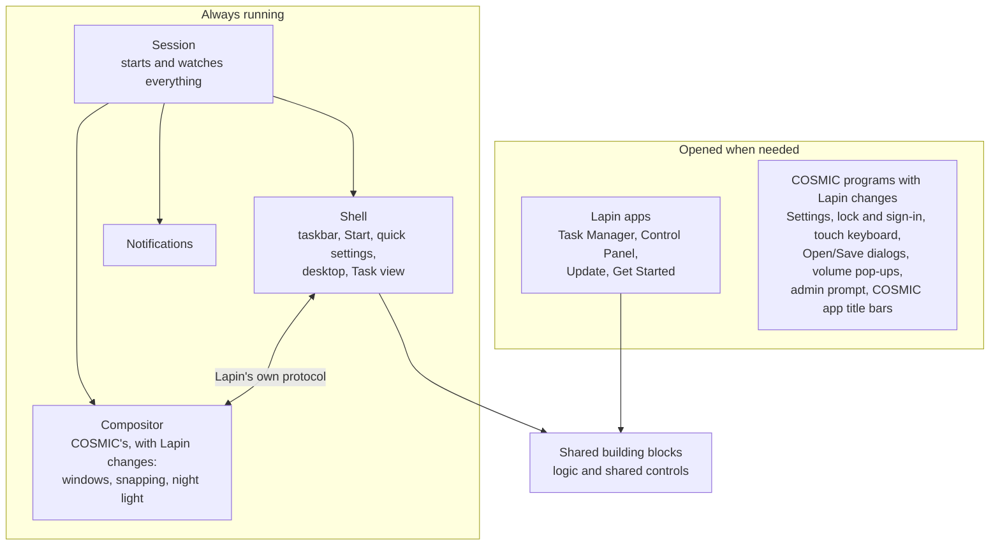

# How it fits together

[Back to the README](../README.md)

Lapin UX is built on COSMIC, System76's Rust desktop. It writes its own taskbar, Start menu and apps, and reuses COSMIC's compositor and services, carrying small Lapin changes on top of a few COSMIC programs. Each change is kept in its own file and pinned to COSMIC's stable releases, so COSMIC updates don't break it. The [technical reference](TECHNICAL.md) explains every part.
