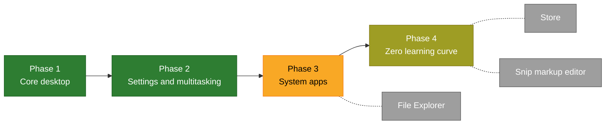

# Roadmap

[Back to the README](../README.md) · [Screenshots](SCREENSHOTS.md) · [Work log](WORKLOG.md)

The work is split into four phases. Green is done, yellow is partly done, grey is still to build.

| Phase | What it covers | Progress |
|---|---|---|
| 1. Core desktop | Taskbar, Start, notifications, tray, wallpaper and theme | `██████████` 12 of 12 |
| 2. Settings and multitasking | Settings, quick settings, notification centre, Alt+Tab, Task view, snapping | `██████████` 9 of 9 |
| 3. System apps | File Explorer, Update, Control Panel | `███████░░░` 4 of 6, 1 partly |
| 4. Zero learning curve | Lock and sign-in, Task Manager, snipping, touch keyboard, accessibility, sounds… | `████████░░` 15 of 19, 2 partly |

*Last updated: 8 November 2026 (progress figures as of build `41a45cf`).*

## Track it on GitHub

Each phase is a [milestone](https://github.com/znraznra/lapin-ux/milestones), and each big item is a tracking issue with sub-issues, so progress shows as a bar.

| Milestone | Tracking issue | State |
|---|---|---|
| [Phase 1: Core desktop](https://github.com/znraznra/lapin-ux/milestone/1) | [#66](https://github.com/znraznra/lapin-ux/issues/66) | Done |
| [Phase 2: Settings and multitasking](https://github.com/znraznra/lapin-ux/milestone/2) | [#67](https://github.com/znraznra/lapin-ux/issues/67) | Done |
| [Phase 3: System apps](https://github.com/znraznra/lapin-ux/milestone/3) | [#68](https://github.com/znraznra/lapin-ux/issues/68) | Open: [File Explorer #71](https://github.com/znraznra/lapin-ux/issues/71), [Open/Save navigation pane #76](https://github.com/znraznra/lapin-ux/issues/76) |
| [Phase 4: Zero learning curve](https://github.com/znraznra/lapin-ux/milestone/4) | [#69](https://github.com/znraznra/lapin-ux/issues/69) | Open: [Store #77](https://github.com/znraznra/lapin-ux/issues/77), [Snip markup editor #78](https://github.com/znraznra/lapin-ux/issues/78), [Accessibility #79](https://github.com/znraznra/lapin-ux/issues/79), requests [#41](https://github.com/znraznra/lapin-ux/issues/41), [#57](https://github.com/znraznra/lapin-ux/issues/57), [#58](https://github.com/znraznra/lapin-ux/issues/58) |
| [Hardware retest](https://github.com/znraznra/lapin-ux/milestone/5) | [#70](https://github.com/znraznra/lapin-ux/issues/70) | Gate before File Explorer: every fix waits here until confirmed on real hardware |

Needs more details from testers: [#32](https://github.com/znraznra/lapin-ux/issues/32), [#34](https://github.com/znraznra/lapin-ux/issues/34) and [#50](https://github.com/znraznra/lapin-ux/issues/50).

## What's next

In this order:

1. **Retest on real hardware** ([#70](https://github.com/znraznra/lapin-ux/issues/70)). Help here is the most valuable thing right now; see [CONTRIBUTING.md](../CONTRIBUTING.md).
2. **File Explorer** ([#71](https://github.com/znraznra/lapin-ux/issues/71)), then the **Store** ([#77](https://github.com/znraznra/lapin-ux/issues/77)).
3. **Snip markup editor** ([#78](https://github.com/znraznra/lapin-ux/issues/78)).

## Phase 1 — core desktop (done)

- [x] Taskbar: centred or left icons, pinned and running apps, window picker, jump lists, End task, badges and progress, attention flash, a search box you can type in, a Start button picture of your choice (the Lapin UX logo by default), solid by default with Transparency effects to make it see-through
- [x] Taskbar labels, smaller buttons, auto-hide, one taskbar per monitor with a main display you choose, Show desktop corner
- [x] System tray with app menus, older X11 and Wine tray icons included
- [x] Clock with calendar, seconds if you want them
- [x] Start: type to search, pinned apps and folders, All apps, Recommended, account and power menus, Uninstall
- [x] Search: apps, Settings pages, files, text inside documents, the web
- [x] Start slides up as it opens, without touching the taskbar, and slides across to All apps and back
- [x] Notifications: pop-ups, notification centre, agenda, Focus, Do not disturb on a schedule
- [x] Wallpaper and theme: accent colour, rounded corners, an opaque taskbar (see-through if you turn on Transparency effects)
- [x] Look: Selawik font, Fluent Emoji, full-colour app icons, sharper text (system and monospace font, smoothing and contrast in Settings > Fonts)
- [x] Session: starts everything and restarts anything that crashes
- [x] Arch package and one-step installer *(installs on a real Arch-based PC; first test's fixes waiting for a retest)*

## Phase 2 — settings and multitasking (9 of 9)

- [x] Quick settings: Wi-Fi, Bluetooth, sound and per-app volume, media, brightness, Energy saver, hotspot, VPN, accessibility
- [x] Edit quick settings, Night light with a schedule, rotation lock
- [x] Notification centre with calendar
- [x] Alt+Tab and taskbar thumbnails
- [x] Task view, virtual desktops, names and wallpaper per desktop
- [x] Snapping, snap layouts, Snap assist, snap groups
- [x] Drag to reorder pinned apps
- [x] **Settings app** laid out the way you'd expect — *all 5 stages done (frame, categories, Home, the look inside every page, About, the page layout with Taskbar, Start, Notifications, Night light and Multitasking pages; Installed apps, Storage, Clipboard, Lock screen, Sign-in options, Privacy & security and Update inside Settings; search and links from everywhere); see [Settings](SCREENSHOTS.md#the-settings-app)*
- [x] Volume and brightness pop-ups

## Phase 3 — system apps (4 of 6, 1 partly)

- [ ] **File Explorer** laid out the familiar way — *COSMIC Files fills in for now*
- [~] Open and Save dialogs — *tidy bottom row and title bar done; the side pane is still COSMIC's*
- [x] "How do you want to open this file?" picker
- [x] Update (inside Settings): system and Flatpak apps, history, restart prompt, background check
- [x] Firmware updates (BIOS, SSDs, docks) *(not yet tried with real firmware)*
- [x] Control Panel — every item opens the matching Settings page

## Phase 4 — zero learning curve (15 of 19, 2 partly)

- [x] Night light and desktop peek
- [x] Touchpad gestures *(untested on a real touchpad)*
- [x] Window open, minimize and restore animations
- [~] Familiar title bars (app icon, title on the left) — *done for most apps, Lapin's apps and (optionally) COSMIC's own apps; other apps that draw their own title bar keep theirs on purpose*
- [x] Power-user menu (Super+X), Run, Super+P, Ctrl+Alt+Del, Alt+F4 Shut Down dialog
- [x] Lock screen, sign-in screen, fingerprint sign-in
- [x] Get Started (first-sign-in setup)
- [x] Desktop: Properties, This PC, Network and Control Panel icons, classic right-click menu
- [x] Task Manager: Processes, Performance, Startup apps, Details
- [x] Task Manager: Users and Services tabs
- [x] Snipping: rectangle, window, full screen
- [ ] Snip markup editor (pen, highlighter, crop)
- [x] Keyboard layout switcher and input methods (Japanese, Chinese…)
- [x] Touch keyboard
- [~] Magnifier and colour filters; Narrator — *paused for now (it didn't work reliably); contrast themes off for now: none of our own yet*
- [x] System sounds and pointers (style, busy colour and size in Settings)
- [ ] **Store**
- [x] A clear admin prompt
- [x] Richer file preview in search

*`[~]` = partly done.*

## Not planned

Left out on purpose: theming of GTK 3, GTK 4 and KDE (Qt) apps, the newer Start layout, search highlights, widgets and Copilot, and a closing animation for windows. Parked for later: live captions, Super+H voice typing and see-through (Mica) app windows. Some things aren't included because they belong to other companies' services or files: Microsoft account, OneDrive, Phone Link, and the Segoe fonts and sounds (open look-alikes are used instead, and Nextcloud or KDE Connect cover the same jobs).
