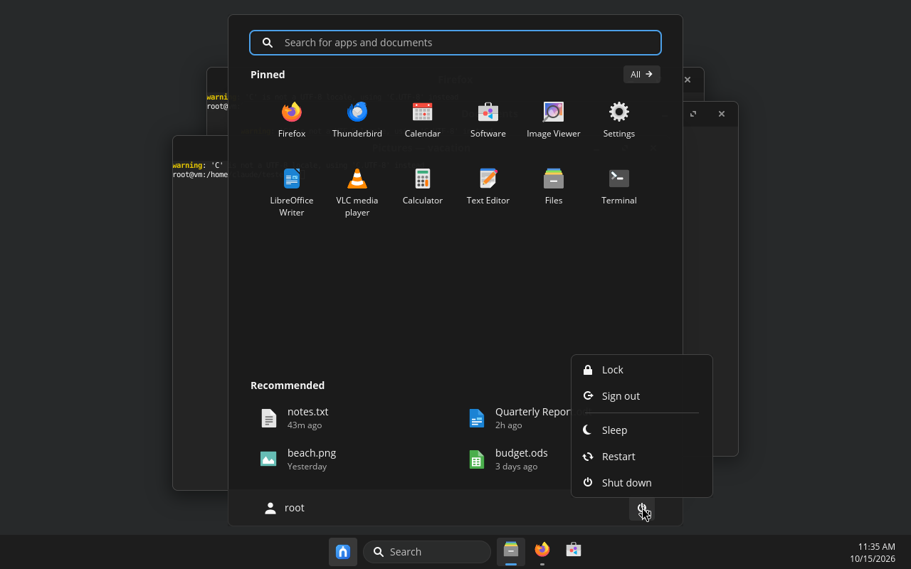
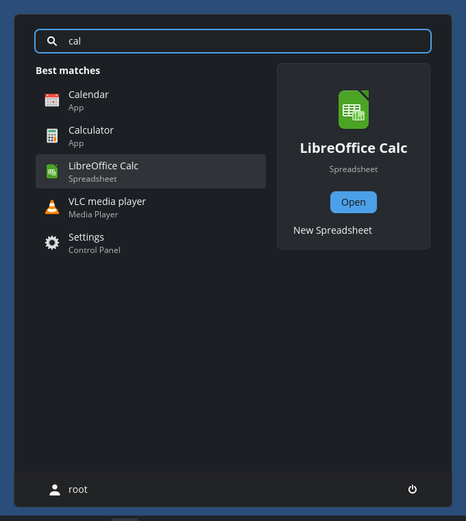
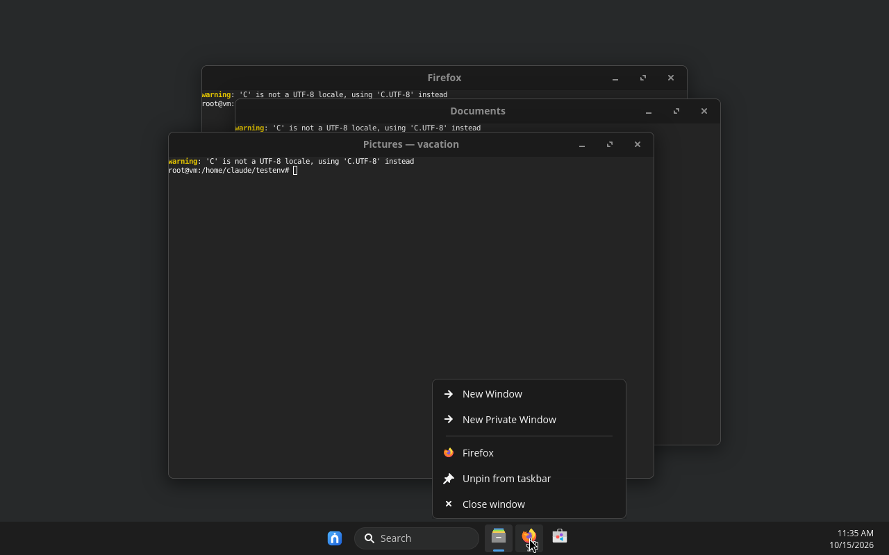
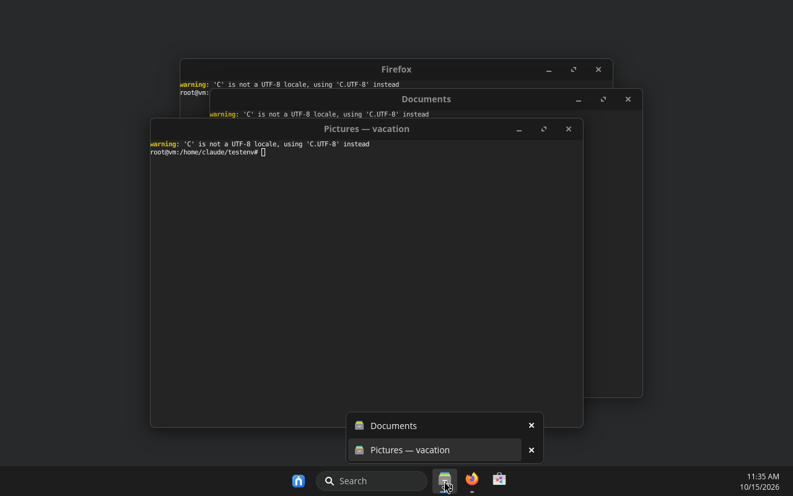
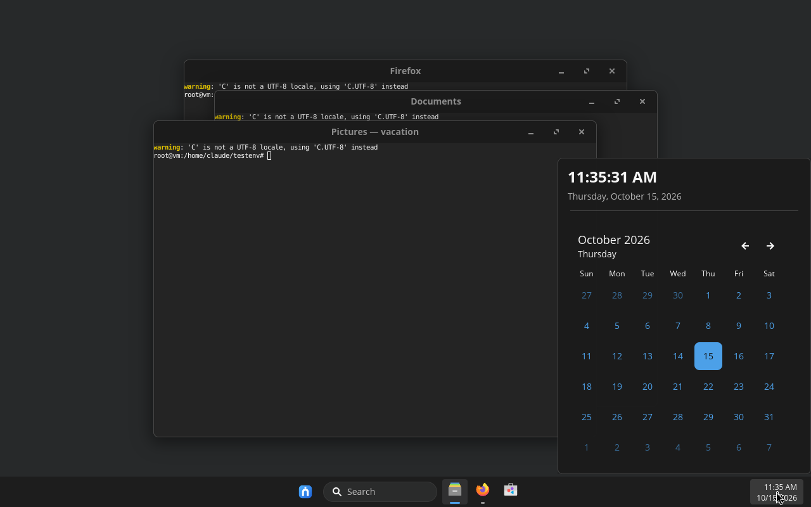
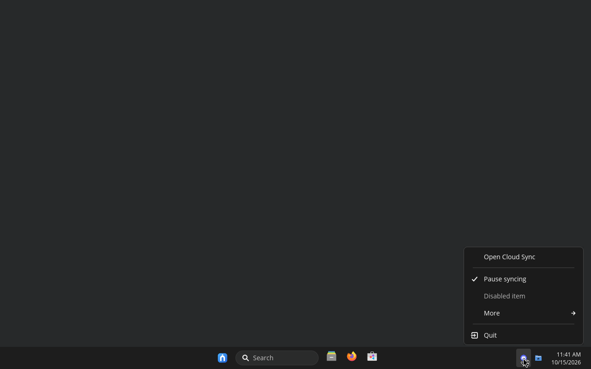
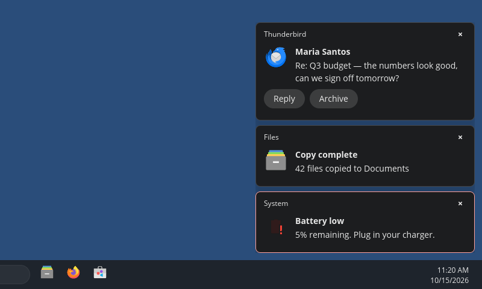

# Lapin UX — technical reference

> The friendly overview is in the [README](../README.md), with [screenshots](SCREENSHOTS.md) and the [roadmap](ROADMAP.md) on their own pages. This page is the full technical detail: every feature and setting, architecture, building, testing and credits.

A COSMIC-based DE written in Rust, designed for a zero learning curve:
everything is where you expect it, with no plugins and no console needed for
everyday tasks.

A Linux desktop that feels familiar from the first minute: a
centered taskbar, a Start menu with search, pinned apps and recent files,
toasts in the bottom-right corner, a system tray, and the keyboard shortcuts
people already know. Written in Rust with [libcosmic]/iced, running on the
COSMIC compositor. Arch Linux first.

> Lapin UX matches *behaviour, layout and feel*. Everything it ships is open
> source: its own code is GPL-3.0, and the third-party font and icons it uses
> by default (Selawik, Fluent UI System Icons, the Win11 icon theme) are used
> under their own open-source licences, with all trademarks belonging to their
> owners. Lapin UX is an independent project, not affiliated with or endorsed
> by Microsoft. See [Third-party assets and trademarks](#third-party-assets-and-trademarks).

| | |
|---|---|
|  |  |
|  |  |
|  |  |



## What's in the box (phase 1)

Every part, by area. Each area has its own file in `docs/technical/`, so
a change to one area only touches that file.

- [The desktop shell](technical/shell.md): Taskbar, Start menu, notifications, desktop icons, auto-hide, window previews, clipboard and emoji, quick settings, windows reopening where they were, Task view and snapping.
- [Settings](technical/settings.md): The Settings app (`lapin-ux-settings`).
- [System parts](technical/system-parts.md): Pop-ups and admin prompt, title bars of COSMIC apps, snipping, system tools, lock screen and sign-in, typing, accessibility.
- [Look and sound](technical/look-and-sound.md): Text rendering, sounds and pointers.
- [Explorer and file dialogs](technical/explorer.md): The Explorer (`lapin-explorer`) and the Open/Save dialogs.
- [Photos](technical/photos.md): The offline Photos app (`lapin-ux-photos`): dark gallery, light viewer, favorites.
- [Session and first-run defaults](technical/session.md): The session (`lapin-ux-session`) and the defaults written on first run.
- Static analysis: CodeQL runs through the repository's default setup (actions, Python and Rust), not a workflow, because GitHub rejects advanced-workflow uploads while the default setup is on. `.github/workflows/semgrep.yml` (Semgrep `p/default` and `p/secrets`) uploads findings to the Security tab. Both only report and are not blocking until the first findings are triaged.
- Automated checks: `.github/workflows/ci.yml` runs on every pull request: `shellcheck` and the uninstall tests (`tools/test-uninstall/run.sh`, which guard coexistence and clean uninstall), and a Trivy scan of dependencies (`Cargo.lock`) and secrets. It only reports. The COSMIC forks are not built there (too heavy for a plain runner), so `cargo check --locked` stays a local check.

## Architecture

```
display manager ──> start-lapin-ux ──> lapin-ux-session
                                      ├─ lapin-ux-comp / cosmic-comp  compositor (ours = upstream + small patches)
                                      ├─ lapin-ux-shell           taskbar ×N, Start menu, tray   ← ours
                                      ├─ lapin-ux-notifyd         notification toasts + centre   ← ours
                                      ├─ lapin-ux-xembed          X11/Wine tray icons → tray     ← ours
                                      ├─ cosmic-settings-daemon theme, media keys              (reused)
                                      ├─ cosmic-bg              wallpaper                      (reused)
                                      ├─ lapin-ux-osd           volume pop-ups, admin prompt   (COSMIC's + patch)
                                      ├─ cosmic-idle            screen blanking                (reused)
                                      └─ lapin-ux-greeter       lock screen (COSMIC's + patch)
```

| Crate | What it is | Depends on libcosmic |
|---|---|---|
| `lapin-ux-core` | Search ranking, taskbar model, toast queue, clock formats, recent files, pins, calendars, file operations, snap layouts, displays, night light, process and system monitoring, updates (incl. fwupd), sounds, OS name, users and services, search preview. 99 unit tests. | no |
| `lapin-ux-shell` | Taskbar, Start menu, tray, popups, first-run defaults | yes |
| `lapin-ux-notifyd` | Notification server and toasts | yes |
| `lapin-ux-session` | Compositor handshake and process supervisor. 2 tests. | no |
| `lapin-ux-xembed` | XEmbed tray (X11/Wine icons) as StatusNotifierItems | no |
| `lapin-ux-taskmgr` | Task Manager | yes |
| `lapin-ux-control` | Control Panel | yes |
| `lapin-ux-update` | Update (pacman + Flatpak + firmware) | yes |
| `lapin-ux-welcome` | First-run setup | yes |
| `lapin-ux-ui` | Shared widget styles (4 px buttons, round slider thumbs, sidebar items, icon + title for title bars) | yes |

`lapin-ux-comp` (`packaging/lapin-ux-comp`) is upstream cosmic-comp at a
pinned commit plus seven patches adding `lapin_shell_v1` (`protocols/`, version 3): snap a
window into a fraction of the work area, tell the shell when a window asks
for attention, desktop peek, night light (also on the real-screen KMS path),
touchpad swipes for the shell, the Alt key's state for the shell's Alt+Tab
switcher (v3 `alt` event), and a window-open animation that grows the window
at its real size (patch 0006, #42); plus title bars with the app icon and a
left-aligned title. Patch 0007 (#28) publishes `_NET_WORKAREA` on the X root
window in the Lapin session: the screen minus layer-shell exclusive zones
(the taskbar), in X coordinates, updated when layers map, change or go and
when outputs or the Xwayland scale change; X11 apps such as Steam place their
own pop-ups inside it. Everything else works on stock cosmic-comp.

Five more COSMIC programs are built with small patches, each as its own
package that replaces the original: `lapin-ux-greeter` (lock and sign-in
screens), `lapin-ux-osk` (touch keyboard), `lapin-ux-osd` (volume/brightness
pop-ups and the admin prompt), `lapin-ux-settings` (Settings) and `lapin-ux-portal` (file dialogs; COSMIC's
portal built against a patched COSMIC Files). Each patch keeps Lapin's code
in its own file with a few call sites and is pinned to a COSMIC stable
(epoch) release, so it rebases easily when COSMIC updates.

Window tracking supports two backends: cosmic-comp's protocols (full
control) and `wlr-foreign-toplevel-management` (sway, Hyprland, labwc,
niri…), so the shell also runs on wlroots compositors.

All settings use cosmic-config and apply live:
`~/.config/cosmic/dev.lapinux.Shell/v1/` (`pinned_taskbar`, `pinned_start`,
`alignment` = `Center`/`Left`, `position` = `Bottom`/`Top` (#41; Start, Quick settings, panels and pop-ups follow the bar to the top), `show_search`, `clock_24h`, `clock_seconds`,
`show_desktop_corner`, `tray_inline`, `web_search`, `hide_web_search`, `desktop_icon_size`, `desktop_sort`, `hide_desktop_icons`, `desktop_auto_arrange`, `auto_hide`, `multi_display`, `hotspot_password`).

## Install on Arch

```sh
git clone https://github.com/znraznra/lapin-ux.git
cd lapin-ux
./install.sh
```

That's all: the script installs the build tools, builds Lapin UX and its
compositor build (`lapin-ux-comp`, for snap layouts and taskbar flashing),
and pacman installs every other dependency automatically (COSMIC services,
NetworkManager, Bluetooth, sound, search, fonts for other scripts).
Nothing to install by hand. The Selawik font, the Fluent UI icons and the
Win11 icon theme all ship inside this repository (`data/` and
`third_party/`), so the build downloads nothing but Rust crates and the
pinned cosmic-comp source. The package replaces any separately installed
`win11-icon-theme`.

`sh tools/preflight.sh` shows what's already installed (optional).

Log out, pick **Lapin UX** in your display manager's session list, log in.
### Uninstall

Sign out of Lapin UX, log into another desktop (or a text console) and run
`lapin-ux-uninstall` (`./uninstall.sh` in the source folder is the same
script and still works once the packages are gone). `--dry-run` shows the
plan; `--settings-only` only restores settings (for someone who already ran
`pacman -R`).

- **Restore point.** `start-lapin-ux` (and `lapin-ux-cursors`) run
  `lapin-ux-uninstall --snapshot` before Lapin UX first changes anything:
  GTK `org.gnome.desktop.interface` font-name, document-font-name,
  icon-theme, cursor-theme (dconf); COSMIC's interface font, icon theme,
  wallpaper, shortcuts (`custom`, `system_actions`), focus policy and the
  four theme folders; `~/.local/share/icons/default/index.theme`. Saved once
  in `~/.local/state/lapin-ux/restore`. Accounts set up before this existed
  get a `late` marker instead (no originals). GTK's cursor-size is swapped
  per session too.
- **Your own values first (#23).** When a setting holds Lapin's value outside
  Lapin UX and the restore point has no usable value, other desktops (and
  uninstalling) get the user's own value found elsewhere before any default:
  icon theme, pointer and font from `~/.config/gtk-3.0|gtk-4.0/settings.ini`,
  the pointer from `~/.icons/default/index.theme`, the icon theme from
  whichever of GTK's and COSMIC's settings isn't Lapin's. An existing
  other-desktops copy is never replaced by a Lapin value written outside the
  session.
- **Restore.** A value is only changed while it is still Lapin UX's
  (Selawik, Lapin-UX/Win11 icons, Lapin's pointer, wallpaper or shortcuts),
  so later choices made elsewhere stay. With a restore point it goes back to
  the saved value, otherwise to the desktop's default. Then
  `~/.config/cosmic/dev.lapinux.*`, `~/.local/state/cosmic/dev.lapinux.*`,
  `~/.cache/lapin-ux`, the pointer pack and `~/.local/state/lapin-ux` are
  deleted; `~/.config/cosmic` too (after asking) when no COSMIC program is
  left. Other accounts that used Lapin UX are restored the same way.
- **System.** Removes Lapin UX's Howdy line from the PAM files. Login
  screen: if greetd runs Lapin UX's sign-in screen, COSMIC's own
  (`cosmic-greeter`) goes back in its place, so the same login setup keeps
  working and lists every installed desktop. With COSMIC installed, every
  COSMIC part Lapin stood in for comes back (greeter, Settings, OSD, OSK,
  portal); otherwise those wanted by something outside Lapin. All of them
  must be installable first (`pacman -Si`), or nothing is changed; if the
  install fails, Lapin's packages stay. Then `pacman -Rn` the Lapin
  packages, and (without COSMIC) COSMIC parts that became orphans. Other new
  orphans (NetworkManager, Bluetooth, PipeWire…) are only listed.
- **Plain `pacman -R` is covered too.** The desktop package's `pre_remove`
  runs `lapin-ux-uninstall --settings-only --yes` for every account that
  used Lapin UX (skipping one still signed in, with a note). The greeter
  package's `post_remove` waits for pacman to finish; if no `cosmic-greeter`
  arrived and greetd would be left without a greeter, it switches to an
  installed login manager (sddm, gdm, plasmalogin, lightdm, lxdm, ly), or
  else sets greetd to a text login (`agreety`, old config kept as
  `config.toml.lapin-ux-bak`) and says how to get a graphical one back.
- **Sign-in screen and boot animation (#100).** `tools/lapin-ux-login
  use-lapin` first saves the enabled display manager, `/etc/greetd/config.toml`
  and the Plymouth theme to `/var/lib/lapin-ux/login` (the first record is
  never overwritten), then points greetd at Lapin UX's sign-in screen and
  enables it in place of the old display manager (rolled back if greetd
  can't be enabled). The boot animation (a `lapin-ux` Plymouth theme: the
  firmware's BGRT logo with a spinner, or the system's own logo from
  `/etc/os-release` when the firmware has none) is set only when Plymouth is
  already set up; the initramfs configuration and the boot loader's are not edited, but the initramfs itself is rebuilt to apply the theme (the Plymouth theme setting changes).
  `lapin-ux-login restore`, `lapin-ux-uninstall` and the desktop package's
  `pre_remove` put everything back. pacman doesn't stop a removal when a
  scriptlet fails, so `pre_remove` first keeps a runnable copy of the tool in
  `/var/lib/lapin-ux/login/lapin-ux-login-recover`. If your own display manager
  can't be enabled again, greetd stays on and the whole record is kept. If only
  the boot animation can't be put back, the sign-in screen is already restored
  (greetd off, your display manager on), the record is kept for the boot
  animation, and `restore` reports failure until that is fixed. Either way the
  message says how to finish it.
  `use-lapin` and `restore` share one lock, and a failed `use-lapin` never
  deletes a record from an earlier run. `./install.sh` and the first-run setup
  ask (Enter = Lapin UX's; `--keep-login` for unattended runs). Tests:
  `tools/test-login/run.sh`.
- **Sign-in screen picture and font (#100).** The sign-in screen shows the
  selected (last signed-in, else the first) user's lock screen picture and
  system font, read by the greeter daemon from that user's `dev.lapinux.Shell`
  config. The daemon logs what it read (`journalctl -b -u cosmic-greeter-daemon`,
  lines starting "Lapin UX:"), so a wrong picture or font can be traced.
- Tests: `tools/test-uninstall/run.sh` (throwaway homes; needs dconf; 55
  checks, scenario I covers giving other desktops' skipped startup parts back).

## Try it without installing

From a terminal inside any Wayland session (COSMIC, GNOME, KDE, sway…) with
`cosmic-comp` installed:

```sh
cargo build
XDG_CONFIG_HOME="$(mktemp -d)" PATH="$PWD/target/debug:$PATH" XDG_CURRENT_DESKTOP=LapinUX:COSMIC \
  dbus-run-session -- target/debug/lapin-ux-session
```

To see the default font and icons in this mode, install them into your
home first with `tools/install-user-assets.sh` (undo with `--remove`).

cosmic-comp detects the parent session and opens as a window containing a
full Lapin UX desktop. Close the window (or `pkill lapin-ux-session`) to stop.

See [TESTING.md](../TESTING.md) for a step-by-step test checklist.

## Develop

```sh
cargo test --workspace     # unit tests (core logic, session handshake)
cargo clippy --workspace   # clean at the time of writing
RUST_LOG=lapin_ux_shell=debug target/debug/lapin-ux-shell   # run the shell alone in a session
target/debug/lapin-ux-shell start                          # toggle Start in the running shell
python3 tools/make-wallpaper.py                          # re-render wallpapers
python3 tools/make-fluent-icons.py <fluentui-system-icons checkout>   # regenerate data/icons/Lapin-UX*
python3 tools/make-fluent-emoji.py <fluentui-emoji checkout> <out>    # rebuild the emoji font (needs nanoemoji)
```

`lapin-ux-core` holds anything that can be tested without a display; put new
logic there first.

## Renaming

The working name is easy to change: `crates/lapin-ux-core/src/lib.rs` (`ids`),
`data/session/*`, `data/systemd/*`, `packaging/arch/PKGBUILD`.

## Not done yet

See the [roadmap](ROADMAP.md).

## License

Lapin UX's own code and original artwork (Start mark, wallpapers) are
GPL-3.0-only. Window tracking, the tray watcher/menus and the session start
script are adapted from System76's GPL-3.0 COSMIC projects; see file headers.

## Third-party assets and trademarks

Lapin UX uses the following open-source assets by default. Each is used under
its own licence, which is shipped with it; nothing here changes or adds to
those terms.

| Asset | Used for | Licence | Where | Source |
|---|---|---|---|---|
| Selawik 1.01, © Microsoft Corporation | Interface font | SIL Open Font License 1.1 | `data/fonts/selawik/` (unmodified, licence in `OFL.txt`) | [microsoft/Selawik](https://github.com/microsoft/Selawik) |
| Fluent UI System Icons, © Microsoft Corporation | Symbolic icons in `Lapin-UX` / `Lapin-UX-dark` | MIT | `data/icons/Lapin-UX/symbolic/` (renamed to freedesktop names and recoloured by `tools/make-fluent-icons.py`; licence in `LICENSE-fluentui-system-icons`) | [microsoft/fluentui-system-icons](https://github.com/microsoft/fluentui-system-icons) |
| Win11 icon theme by yeyushengfan258 (based on Ubuntu's Yaru) | App, folder, file, shortcut and desktop icons | GPL-3.0 | `third_party/win11-icon-theme/` (unmodified, pinned commit in `UPSTREAM.md`; licence in `COPYING`) | [yeyushengfan258/Win11-icon-theme](https://github.com/yeyushengfan258/Win11-icon-theme) |
| Fluent Emoji, © Microsoft Corporation | All emoji (built into the *Lapin Fluent Emoji* colour font) | MIT | `data/fonts/fluent-emoji/` (the "Color" artwork rendered into a colour-bitmap font by `tools/make-fluent-emoji.py`; licence in `LICENSE-fluentui-emoji`) | [microsoft/fluentui-emoji](https://github.com/microsoft/fluentui-emoji) |
| Noto fonts (Arch packages) | Only characters Selawik lacks (CJK, other scripts) | SIL Open Font License 1.1 | installed as dependencies | [notofonts](https://github.com/notofonts) |
| Borealis sound theme 0.9a, © 2004 Ivica Ico Bukvic | System sounds (sign-in, notifications, volume, Recycle Bin…) | Artistic License, with the author's note that commercial use is allowed only with GPL/LGPL software | `data/sounds/borealis/` (unmodified, from Ubuntu's `borealis-sound-theme` package; licence in `COPYING`, origin in `SOURCE`) | [ico.bukvic.net](http://ico.bukvic.net/Linux/Borealis_soundtheme/) |

**Mouse pointers.** The optional pointers are *Cursor Concept W11 Tail
HDPi*, **designed by JepriCreations**
([DeviantArt](https://www.deviantart.com/jepricreations),
[jepricreations.com](https://jepricreations.com)). Their licence allows
personal use and modification but not redistribution, so they are **not**
included in this repository or its packages. `lapin-ux-cursors` (offered at
the end of `install.sh`) downloads the pack on your own computer from
[SullensCR's copy](https://github.com/SullensCR/Windows-11-Hdpi-Tail-Cursor-Concept-by-jepriCreations),
converts it to an X cursor theme for your own use under its author's name,
and makes it your pointer.

Installed packages put every licence in `/usr/share/licenses/lapin-ux-desktop-git/`.

**Trademarks.** Microsoft, Windows, Fluent and Selawik are
trademarks of Microsoft Corporation. "Selawik" is a Reserved Font Name under
the OFL, so the font is shipped unmodified under its own name; a modified
version would have to be renamed. Ubuntu and Yaru are trademarks of
Canonical Ltd. COSMIC is a trademark of System76, Inc. Other product names and
app icons in the Win11 theme belong to their respective owners. These names
are used only to identify the assets and what Lapin UX is compatible with or
inspired by; Lapin UX is an independent open-source project and is not
affiliated with, sponsored or endorsed by Microsoft, Canonical, System76 or
any other trademark owner. Lapin UX ships no Microsoft logos, artwork or
proprietary fonts.

Don't want these defaults? Pick any other font or icon theme in COSMIC
Settings; Lapin UX never overwrites your choice.

[libcosmic]: https://github.com/pop-os/libcosmic
