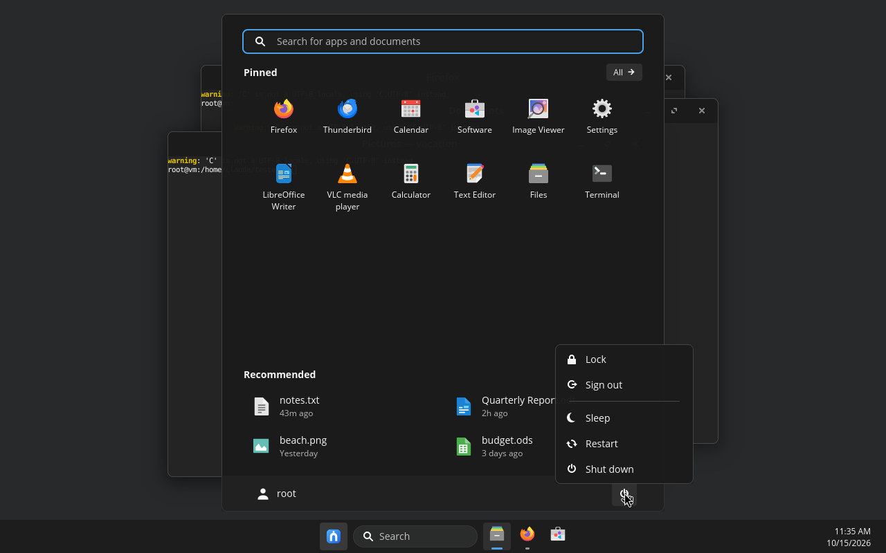
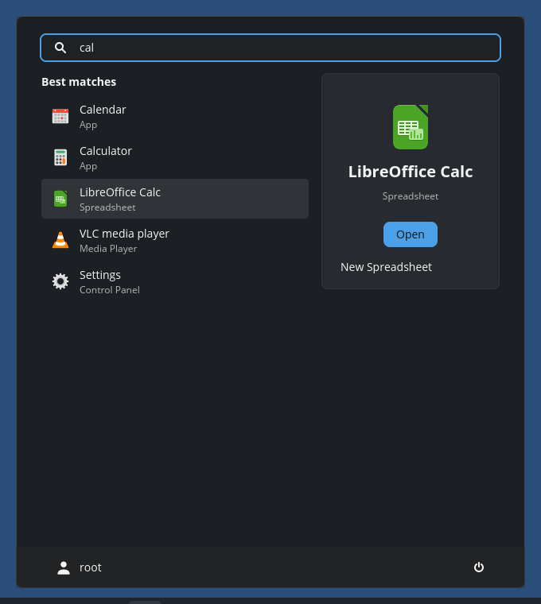
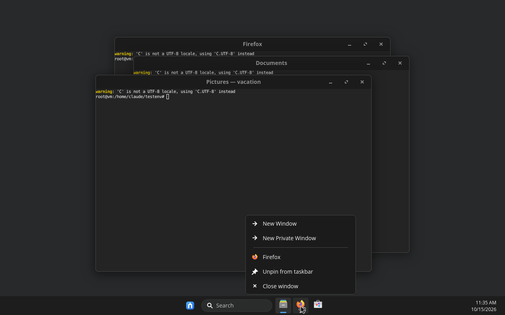
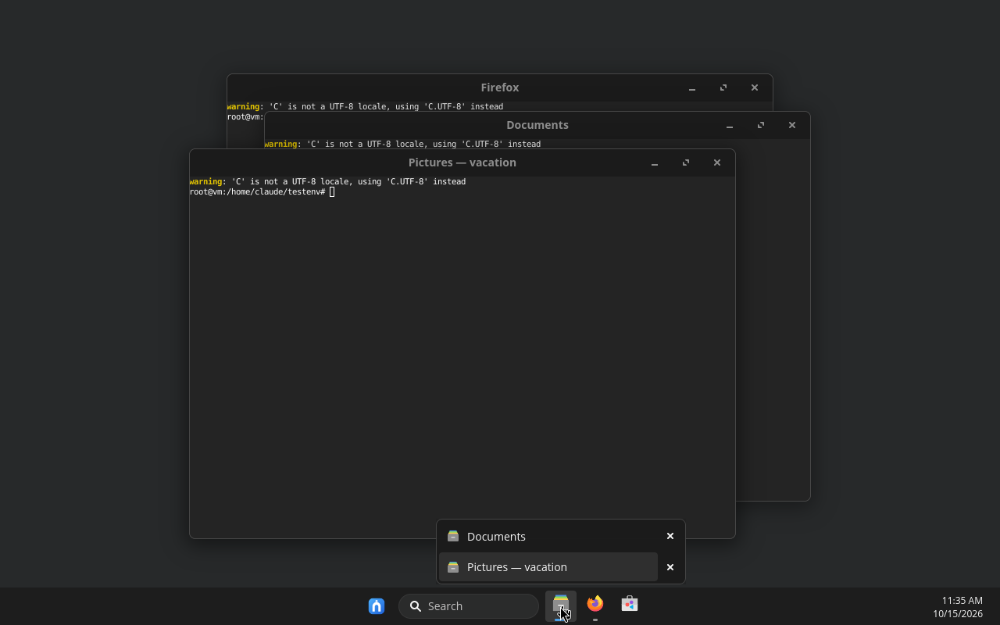
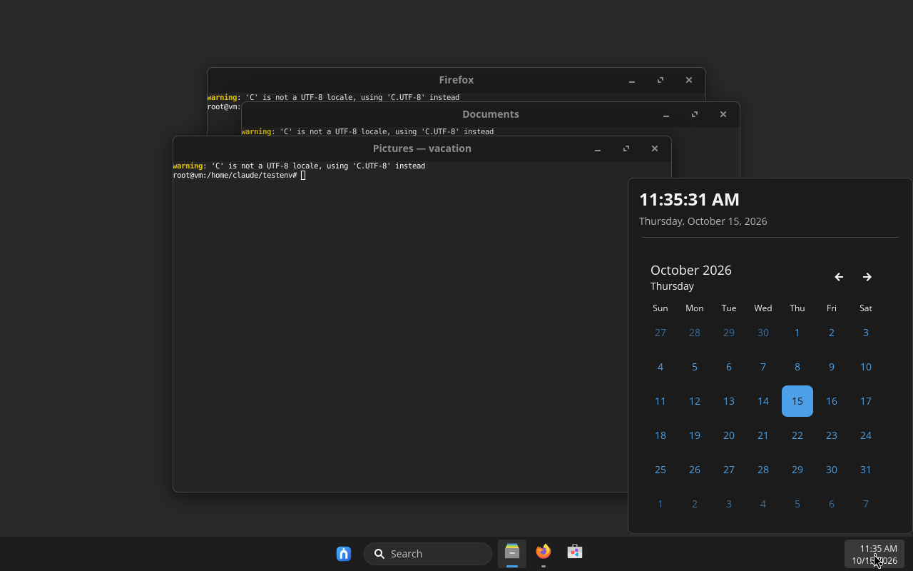
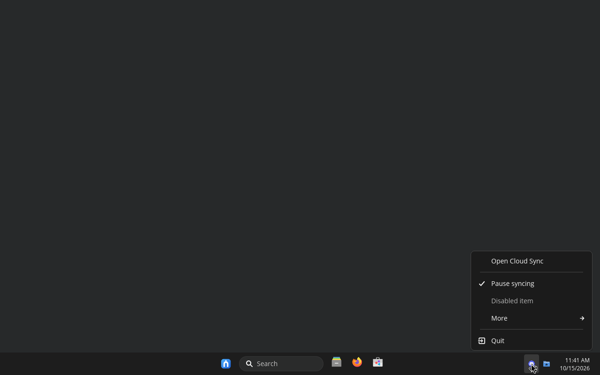
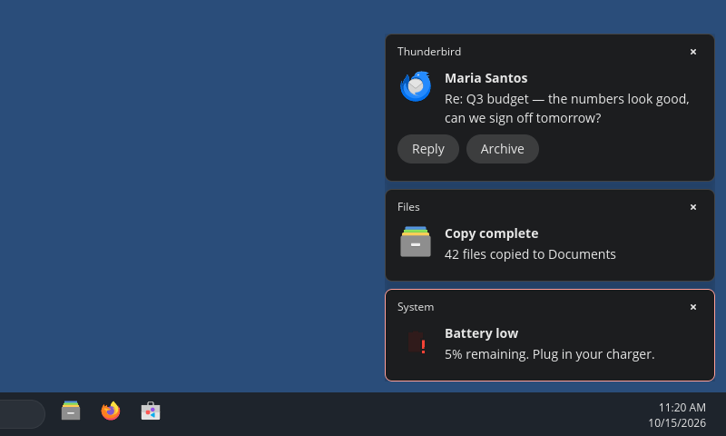

# Lapin UX — technical reference

> The friendly overview is in the [README](../README.md), with [screenshots](SCREENSHOTS.md) and the [roadmap](ROADMAP.md) on their own pages. This page is the full technical detail: every feature and setting, architecture, building, testing and credits.

A COSMIC-based DE written in Rust, designed for a zero learning curve:
everything is where you expect it, with no plugins and no console needed for
everyday tasks.

A Linux desktop that feels familiar from the first minute: a
centered taskbar, a Start menu with search, pinned apps and recent files,
toasts in the bottom-right corner, a system tray, and the keyboard shortcuts
people already know. Written in Rust with [libcosmic]/iced, running on the
COSMIC compositor. Arch Linux first.

> Lapin UX matches *behaviour, layout and feel*. Everything it ships is open
> source: its own code is GPL-3.0, and the third-party font and icons it uses
> by default (Selawik, Fluent UI System Icons, the Win11 icon theme) are used
> under their own open-source licences, with all trademarks belonging to their
> owners. Lapin UX is an independent project, not affiliated with or endorsed
> by Microsoft. See [Third-party assets and trademarks](#third-party-assets-and-trademarks).

| | |
|---|---|
|  |  |
|  |  |
|  |  |



## What's in the box (phase 1)

**Taskbar** (`lapin-ux-shell`), one per monitor
- Centered (or left-aligned) Start button, Search box, pinned and running apps.
- The Search box is a real text field: click it to type on the taskbar (the
  taskbar takes the keyboard only meanwhile); Enter shows the results in
  Start; Esc or clicking away clears it.
- Start button picture: Settings > Personalization > Taskbar > Start button
  icon (the official Lapin UX logo, `docs/assets/lapin-ux-logo.svg`, as the
  default; Dots, Circle, the OS logo from os-release
  `LOGO=`, or a custom SVG/PNG copied to `~/.local/share/lapin-ux`);
  `start_icon` in `dev.lapinux.Shell` (`""` = the logo, which is also shown
  when a chosen picture is missing and is the app icon `dev.lapinux.Shell`,
  #56).
- Right-clicking an icon in the tray drawer (^) opens its menu beside it,
  growing upwards; the drawer stays open until a press outside both.
- Opaque by default, with no blur behind it (#55). Personalization > Colors >
  *Transparency effects* (`transparency_effects` in `dev.lapinux.Shell`,
  off by default; Lapin session only) makes it see-through (82 %) and
  blurred.
- Apps' single-colour tray icons (Steam's black `steam_tray_mono`,
  Electron apps' black icons, `-mono`/`-panel` variants, black SVGs or
  pixmaps) show the **app's own full-colour icon** instead (#52,
  `lapin_ux_core::tray_look`): the item's id, title and owning process
  (name, executable, command-line paths; Electron's generic
  `chrome_status_icon_N` ids are skipped) are matched to an installed app
  by desktop id, window class, executable or name. With no match they're
  tinted like the taskbar's own icons. Only items whose category is
  ApplicationStatus or Communications count as apps; status icons
  (SystemServices, Hardware: network, Bluetooth…) are drawn as sent.
- All windows of an app share a button. Click: open / focus / minimize;
  several windows: a window picker. Middle-click: new instance.
- Accent "pill" under the focused app, short dash for background apps.
- Right-click: recent files that app opened (jump list), the app's own
  actions (e.g. *New Private Window*), pin/unpin, **End task**, close window(s).
- Count badges and progress bars from apps (Unity LauncherEntry: Firefox,
  Thunderbird, Telegram, Discord, Steam…). A window that wants attention
  makes its button flash and stay lit (with `lapin-ux-comp`).
- Drag a file onto a running app's button to bring that app forward.
- **Task view** button (Super+Tab). Several monitors: *Show taskbar apps on*
  (all taskbars / main and where open / where open). Only the current
  desktop's windows are shown.
- **Main display** (several monitors, #31): Settings > System > Display >
  *Make this my main display* (Lapin keys `main_display` and
  `main_display_model` in `dev.lapinux.Shell`: connector name, and make +
  model to find it after a port change). The main display has the tray, the
  desktop icons and notification toasts; other taskbars keep the clock. With
  none chosen (or the chosen one unplugged): the laptop panel, else the
  top-left monitor (`lapin_ux_core::display::pick_main`, shared by the shell,
  notifications and Settings). The OSD, admin prompt, lock screen and new
  windows don't follow it yet.
- System tray (StatusNotifierItem): left-click activates, right-click opens
  the app's menu with checkmarks, disabled items and submenus (or, for an
  item without a menu, asks the app for one with `ContextMenu`). Discord,
  Steam, Nextcloud, etc. show up here. Older X11 and Wine tray icons
  (XEmbed) show up too, through `lapin-ux-xembed` (#33): it owns
  `_NET_SYSTEM_TRAY_S0` on Xwayland, keeps each docked icon window
  off-screen, reads its picture through Composite every half second and
  publishes it as a StatusNotifierItem on its own D-Bus connection (so the
  item goes when the icon does); clicks and scrolling go back to the X window
  as button events.
- Clock with locale-aware date (seconds when turned on, on both taskbar
  sizes; the switch is in Taskbar behaviors and in Settings > Time &
  language > Date & time);
  12 or 24 hours as Settings' Time & language >
  Date & time > 24-hour time says (COSMIC's `military_time`, read only); click
  for a calendar.
- "Show desktop" sliver at the far right (click again to restore).

**Start menu**
- Type immediately to search. Ranking favours exact and prefix matches,
  initials (`vsc` → Visual Studio Code), generic names (`browser`), keywords
  and executables (`nautilus` → Files). Arrow keys + Enter work; Esc steps back.
- Pinned grid (6 × 3): drag to reorder, drop one app on another to make a
  **folder** (rename it, move apps out); pin files, folders and websites (drop
  them on the grid, or *Pin to Start* on a file result). *All apps* with A–Z sections, *Recommended* from recently
  opened files (`recently-used.xbel`) or recently launched apps.
- Search also finds **Settings pages** (Wi-Fi, Display, Dark mode…),
  **files and folders** in your Desktop, Documents, Downloads, Music, Pictures
  and Videos (own background index, hidden folders skipped), and offers
  **Search the web** (DuckDuckGo by default; `web_search` setting, `{}` = query,
  `hide_web_search` to turn it off). Results are grouped Best match / Apps /
  Settings / Folders / Documents / Web with a details card. For files the
  card is a preview pane: the first lines of a text file, the picture itself,
  or a folder's item count, then Open, *Open file location*, Copy path and
  Pin to Start, then size, date modified and location. With LocalSearch installed, **document contents** are
  searched too.
- Right-click any app: pin/unpin to Start or taskbar, **Uninstall** (asks
  first; pacman packages through an admin prompt, Flatpaks directly; core
  desktop packages are refused). Newly installed or removed apps appear the
  next time Start opens.
- Account button: Change account settings, **Change account picture**, Lock,
  Sign out, **Switch user** (LightDM, SDDM, GDM). Power menu: Lock, Sign out,
  Sleep, Restart, Shut down.

**Notifications** (`lapin-ux-notifyd`)
- Full `org.freedesktop.Notifications` server: actions, urgency, replace-id,
  transient, image-path, markup stripped to plain text.
- Up to 3 toasts stacked above the taskbar, 5 s default, critical ones stay,
  hover pauses the timer. Raw `image-data` pictures (chat avatars, photos) shown.
- **Notification centre** (click the clock or Super+N): notifications grouped
  by app with time, per-item and per-app dismiss, Clear all, Do not disturb,
  and a collapsible calendar underneath with **today's agenda** (local
  Evolution calendars, .ics files, calendar links; repeating events) and
  **Focus sessions**. Clicking a notification opens its app.
- Notification settings (gear): Do not disturb on a **schedule**, and per-app
  *Notifications* / *Show banners* switches.
- The clock shows a bell with the unread count, or a muted bell during
  Do not disturb. `lapin-ux-notifyd center` toggles the centre from scripts;
  `dev.lapinux.Notifications` on the session bus exposes `Unread`,
  `DoNotDisturb`, `ToggleCenter` and `ClearAll`.

**Desktop icons** (the contents of ~/Desktop, on the main monitor)
- **Recycle Bin** icon (Open, Empty Recycle Bin); drop files on it to delete.
- Click selects; Ctrl-click, Shift-click and dragging a box select several.
  Double-click / Enter opens, drag moves icons (remembered), F2 renames in
  place, Delete moves to the Trash, picture files show thumbnails.
- Names are 13 px with tight lines (15 px), up to two lines under the icon,
  and the full name on hover/selection (#64). Cells: small 76×80, medium
  92×96, large 120×120.
- **Cut / Copy / Paste** (Ctrl+X/C/V, works with file managers), Ctrl+A.
- **Drag and drop**: icons drag into apps as files; files and links from
  apps drop onto the desktop (links become shortcuts) or onto folders.
- Right-click an icon: Open, Cut, Copy, Copy as path, Rename, Delete. App launchers
  (`.desktop`) show the app's name and icon; one that isn't an installed app
  only runs after *Allow launching* (it could have come from a download).
- Right-click the desktop: View (Large/Medium/Small icons, Show desktop
  icons), Sort by (Name, Date modified, Item type), Refresh, New (Folder,
  Text Document), Display settings, Personalize, Open in Terminal.

**Auto-hide** (right-click the taskbar → Automatically hide the taskbar):
the taskbar disappears and windows use the whole screen; touching the bottom
edge brings it back, and it stays while Start, a menu or a panel is open.

**Window previews**
- Hovering a taskbar button shows a live thumbnail of each of that app's
  windows (captured with `ext-image-copy-capture`); click to switch, × to close.
- Own Alt+Tab switcher: thumbnails in most-recently-used order; hold Alt and
  press Tab to move, release to switch; a quick tap flips between the last two
  windows; Alt+Shift+Tab goes back; Esc cancels.

**Clipboard history and emoji** (Super+V, Super+.)
- One panel with tabs: Emoji (search by name, categories, recently used),
  Kaomoji, Symbols, Clipboard.
- Clipboard history keeps the last 25 texts and pictures you copied
  (watched with `ext-data-control-v1`); pin items to keep them (pinned
  texts survive a restart), delete them, or Clear all. Copies marked as
  secrets by password managers are never recorded.
- Picking a history item puts it back on the clipboard and pastes it into
  the app you were using; picking an emoji or symbol types it there
  (virtual keyboard), without touching your clipboard.

**Quick settings** (network / volume / battery button left of the clock, or Super+A)
- **Media controls** for what's playing (MPRIS).
- Tiles: Wi-Fi, Bluetooth, Airplane mode, Energy saver, Accessibility
  (magnifier, colour filters, screen reader), Mobile hotspot, Nearby sharing,
  Cast, Keyboard layout, VPN, Do not disturb. Each appears only when what it
  needs exists.
- Wi-Fi page: nearby networks, connect to saved, open and password-protected
  networks, disconnect. Bluetooth page: connect/disconnect, and **Add device**
  (pairing with PIN prompts; the shell is the Bluetooth agent).
- Brightness slider (laptops; through logind, no root needed), volume slider
  with mute, sound output picker and **per-app volume mixer**. Scroll over the taskbar button to change volume.
- Battery percentage and time remaining (UPower); the settings gear opens
  COSMIC Settings, and each page links to its settings page.
- **Night light** tile (warm screen filter in `lapin-ux-comp`; optional
  on/off schedule in the `night_light_schedule` setting) and **Rotation lock**
  (tablets and convertibles: the screen follows the accelerometer through
  iio-sensor-proxy unless locked).
- **Edit quick settings** (pencil): unpin tiles, drag them into a new order,
  add them back from the Add list.
- Notifications show **progress bars** and an **inline reply** box (KDE's
  inline-reply extension).

**Windows reopen where they were** (`lapin-ux-comp` 0009, #42): in the Lapin
session the compositor notes each app's window size and position (with
the output) and saves them to `$XDG_STATE_HOME/lapin-ux/window-geometry`
when a window closes; the app's next window opens there (kept on screen,
centred on another output). Dialogs, maximized and snapped windows,
windows coming back from minimize and positions apps ask for are left alone.

**Task view and snapping**
- Task view: windows of the current desktop as thumbnails, desktops below
  (hover to preview, click to switch, × to remove), New desktop, right-click a
  window to move it to another desktop.
- **Snap layouts** (Super+Z): halves, 2/3 + 1/3, thirds, half + quarters,
  quarters, 1/4-1/2-1/4 on wide screens; then **Snap assist** fills the other
  spaces from your windows. Uses `lapin-ux-comp`, which the installer builds.

- **Snap groups**: windows placed together with a snap layout show up as a
  Group card when you hover their taskbar button; clicking it brings them all back.
- Task view: right-click a desktop to **Rename** it or **Choose background**
  (each desktop can have its own wallpaper).
- **Desktop peek**: rest the pointer on the far right of the taskbar and the
  windows disappear until you move away (`lapin-ux-comp`).
- **Touchpad**: three fingers up for Task view, down to show the desktop,
  sideways to switch apps; four fingers sideways to switch desktops.
- New windows fade in as they open; minimize and restore animate to the taskbar.

**Settings** (`lapin-ux-settings`, COSMIC Settings at epoch-1.11.0 with
patches in `packaging/lapin-ux-settings`; in progress, all 5 stages done)
- Familiar layout: account card and colour category icons in the sidebar
  (Home, System, Bluetooth & devices, Network & internet, Personalization,
  Apps, Accounts, Time & language, Accessibility, Privacy & security,
  Update), Find a setting centred in the title bar, back arrow, breadcrumb
  page titles, category pages of rows, Home, and the System page header
  (wallpaper, PC name and model, Rename, Update's last check).
- COSMIC's pages are re-parented under the usual categories at start-up
  (with their usual names), not edited; old links (`cosmic-settings system`…)
  open the matching category.
- Inside pages: every setting its own card with an icon chosen from its
  title, grey descriptions, On/Off beside switches, tidy drop-downs,
  round slider thumbs, 4 px buttons; Power mode and the primary mouse button
  as drop-downs; Add buttons inside rows; About laid out as a name card with
  Device and OS specification cards (Copy, links), then an **About Lapin
  UX** card (#63): version and build from `/usr/share/lapin-ux/version`
  (the package's `pkgver`, its `.gHASH` links to the commit), the GPL-3.0
  licence, credits read from the table in `/usr/share/lapin-ux/CREDITS.md`
  (plus COSMIC, and the extra pointers when installed), the independence
  notice and project links. Search finds it as About Lapin UX, Credits and
  License.
- Page layout (`lapin/settings.rs`): Personalization > Taskbar and
  Start, System > Notifications, Display > Night light and System >
  Multitasking are Lapin pages that read and write the shell's
  `dev.lapinux.Shell` and the notification service's
  `dev.lapinux.Notifications` cosmic-config (both watch them, so changes
  apply at once; Do not disturb goes over the notification service's
  D-Bus property). Panel and Dock are hidden; COSMIC-only pages (Window
  management, Workspaces, X11 compatibility) sit under an "Advanced"
  heading. Notifications lists apps the service has seen (`seen_apps`).
- Pages COSMIC doesn't have (stage 4): Apps > Installed apps (`lapin/apps.rs`:
  launchers + `pacman -Qo`/`-Qi` and `flatpak list` for version, size, date;
  Uninstall via `pkexec pacman -Rs` or `flatpak uninstall`, desktop packages
  protected), System > Storage (`lapin/storage.rs`: `df` + `du` per
  category; Temporary files removes Recycle Bin, thumbnails, app caches,
  Downloads, and old packages with `pkexec paccache -rk0`), System >
  Clipboard (shell keys `no_clipboard_history`, action `clipboard-clear`),
  Personalization > Lock screen (`lock_wallpaper`, `no_signin_picture`, read
  by the greeter patch 0002; greeter patch 0003 draws the lock and sign-in
  screens in the system font by name (Selawik unless one is picked on
  Fonts: patch 0008 reads `system_font` from `dev.lapinux.Shell`, the
  user's own on the lock screen and the last user's on the sign-in screen,
  #62), since the sign-in screen's own user has no font setting; patch 0004 gives the sign-in screen rounded corner
  buttons — accessibility, keyboard layout, a gear to pick the desktop
  session (every installed Wayland/X11 session, so you can switch back to
  KDE, GNOME…) and power, each with a flyout), Accounts > Sign-in options (`lapin/signin.rs`: facial
  recognition with Howdy through `tools/lapin-ux-howdy` — camera choice,
  `howdy -U user -y add/clear`, and Howdy's PAM line added first to
  /etc/pam.d/greetd and cosmic-greeter as `sufficient`, so the password
  still works — run with pkexec under the dev.lapinux.howdy polkit action;
  fprintd enrolment/removal; password + hint through AccountsService),
  Privacy & security (`lapin/privacy.rs`: device encryption from lsblk;
  Recent activity; per-app Location/Camera/Microphone/Screenshot/Background
  switches in the portal permission store), and Update (`lapin/update.rs`,
  same checks/installs as lapin-ux-update, plus Update history from
  pacman.log). `lapin-ux-update` without arguments now opens
  `cosmic-settings lapin lapin-update` (`LAPIN_UX_UPDATE_WINDOW=1` keeps its
  own window); any Lapin page opens with `cosmic-settings lapin <page-id>`.
- Stage 5: "Find a setting" (`lapin/search.rs`) shows up to 8 suggestions
  in a list under the box as you type (page names and descriptions,
  COSMIC's section titles and multi-word lines, Lapin's own setting names)
  and a "Search results" page on Enter or "Show all results"; COSMIC's
  in-page search isn't used in Lapin mode. Everything that opens Settings
  goes through `lapin_ux_core::system::settings_command(page)`: Lapin pages
  (`lapin-…`) open with `cosmic-settings lapin <id>`, falling back to the
  nearest COSMIC page when COSMIC's own Settings is installed. Start search,
  Control Panel, Super+X (Installed apps, Power Options, System, Network
  Connections, Settings), the taskbar menu's "Taskbar settings", desktop
  Display settings / Personalize, quick settings links, the notification
  centre's "More notification settings" and Super+I (Settings Home) all open
  the matching page.
- All Lapin code is in `cosmic-settings/src/lapin/`; COSMIC's files get small
  hooks. The look inside pages comes from opt-in libcosmic patches
  (`packaging/lapin-ux-libcosmic` 0002–0007), turned on only by Lapin
  Settings. The layout switches on only in a Lapin UX session
  (`XDG_CURRENT_DESKTOP` contains `LapinUX`, or `LAPIN_UX_SETTINGS=1`).
- Start-up (#80): in the Lapin session `init` returns at once and the window
  shows "Loading…"; a 20 ms timer then sends `Message::Boot`, which builds the
  pages (`build_pages`) and opens the page asked for on the command line, or Home. Until then `update` ignores
  everything but `Boot`, and `subscription`, `dialog` and `on_app_exit` do
  nothing. COSMIC's own session builds the pages in `init` as before.

**Pop-ups and admin prompt** (`lapin-ux-osd`, a patch on COSMIC's cosmic-osd)
- Volume and brightness keys show a small rounded box 12 px above the
  taskbar: icon, thin bar, number.
- When an app needs admin rights, polkit's request shows as a clear
  "Do you want to allow this app to make changes to your device?": the screen
  dims, a card names the program, *Show more details* lists the action and
  command, and the password box sits above Yes / No.
- `LAPIN_OSD_PREVIEW=volume|brightness|admin` shows one of them for checking.

**Title bars of COSMIC's own apps** (optional, `packaging/arch-cosmic-apps`)
- A small libcosmic patch (`packaging/lapin-ux-libcosmic`) puts the app icon
  and title at the left of COSMIC apps' title bars. It only acts in a Lapin UX
  session (`XDG_CURRENT_DESKTOP` contains `LapinUX`, or `LAPIN_UX_TITLEBAR=1`),
  so the same apps look stock under COSMIC. The opt-in PKGBUILD rebuilds COSMIC
  Settings, Files, Terminal, Text Editor and Store at COSMIC's stable tag with
  the patch applied to the build's private libcosmic copy (lockfiles stay
  frozen). GTK, Electron and Qt/KDE apps keep their own title bars.

**Snipping** (Super+Shift+S or Print Screen)
- The screen freezes and dims; pick Rectangle (drag), Window or Full screen
  from the toolbar. The snip is copied to the clipboard, saved in
  Pictures/Screenshots, and a notification shows it.
- The picture is of the screen with the focused window (else the main
  display), and the overlay opens on that screen. COSMIC's own *Screenshot*
  system action also points at `lapin-ux-shell snip` (`system_actions`, swapped
  per session), so Print never falls back to `cosmic-screenshot` (#53). If
  no picture arrives within 3 s a notification says so; every press logs
  "screenshot requested".

**System tools**
- **Task Manager** (Ctrl+Shift+Esc, Ctrl+Alt+Del, Super+X): Processes (apps with
  their child processes, background processes, CPU/memory/disk, End task, Run
  new task), Performance graphs (CPU, memory, disk, network and one entry per graphics adapter, read from sysfs and DRM fdinfo), Startup apps (turn them on or off), Users
  (who is signed in, from logind, with their CPU and memory; Manage user
  accounts), Details, and Services (every systemd service with PID and status;
  Start, Stop and Restart go through polkit and the admin prompt).
- **Control Panel**: the classic category view and Large icons, opening the
  matching Settings page or tool.
  In Control Panel and Task Manager, typing with nothing focused goes into the
  search box (#96, #97): a key event no widget took is caught by a subscription,
  appended to the search text, and the box is focused. The focus asked for at
  start-up alone wasn't enough on the real session.
- **Update**: checks pacman, Flatpak and firmware (fwupd, via
  `fwupdmgr get-updates --json`) updates, installs them with one
  button (polkit), shows progress and history, and offers a restart when the
  kernel or firmware changed. A background check notifies you when updates are waiting.
- **Get Started**: on the first sign-in, connect to Wi-Fi, choose light or
  dark mode, and optionally install the extra mouse pointers.
- Desktop icons: **Properties** (Alt+Enter), *This PC*, user folder, *Network*
  and *Control Panel* icons, *Open with ›* with **Choose another app** ("How do
  you want to open this file?"), *Compress to ZIP file*, *Show more options*.
- Super+P (*Project*), Ctrl+Alt+Del security screen, Alt+F4 on the desktop opens
  *Shut Down* with your Linux's name.

**Lock screen and sign-in** (`lapin-ux-greeter`, a patch on COSMIC's greeter)
- Lock screen: big clock and date over the wallpaper; click or type to get the
  sign-in panel (round picture, name, password; network, battery,
  accessibility and power bottom right). The login screen adds the user list
  bottom left. Fingerprint sign-in works through fprintd (optional).
- The lock screen checks the password through the `cosmic-greeter` PAM
  service; `lapin-ux-greeter` ships `/etc/pam.d/cosmic-greeter` in Arch's
  style (`include system-local-login`; Arch has none, and without it every
  unlock fails). Account pictures are cut to a circle when loaded.
- Opening the sign-in panel is a 200 ms eased move (#54): the dark veil
  fades in as the panel rises 24 px into place, and Esc fades it back out
  over the clock face (greeter patch 0008, `lapin::Fade`). The compositor
  grows the blur behind it over the same 200 ms and back
  (`lapin-ux-comp` 0011, `LapinBlurFade`, lock surfaces in the Lapin
  session only).

**Typing**
- With several keyboard layouts or fcitx5 input methods, the taskbar shows
  the current one (**ENG / US**, or あ, 拼…); click to pick, **Super+Space** for the next.
- **Touch keyboard** (`lapin-ux-osk`, a patch on COSMIC's on-screen keyboard)
  with a familiar look, emoji and clipboard buttons; right-click the
  taskbar → *Show touch keyboard button*.

**Accessibility**
- **Narrator is paused** until further notice (`screen_reader::PAUSED` in the
  shell): no quick settings tile, Ctrl+Super+Enter does nothing, search
  doesn't offer it, Settings > Accessibility > Vision hides the screen reader
  rows in the Lapin session, and a running screen reader is turned off. What
  follows describes it for when it comes back.
- Quick settings → Accessibility: Magnifier, Colour filters, **Narrator**
  (Orca; Ctrl+Super+Enter). Contrast themes are turned off for now (Lapin UX
  has none of its own yet; COSMIC's high-contrast palette didn't work as
  one): no quick setting, no shortcut, hidden in Settings and on the lock
  screen; an upgrade turns a high-contrast palette off again.
- Narrator needs Orca and a voice for speech-dispatcher (`espeak-ng`, both
  optional dependencies; on Arch speech-dispatcher's voice is optional too,
  and without one Orca runs silently). Until both are there, quick settings
  leaves the Narrator switch out, and Settings → Accessibility → Vision →
  Screen reader shows **Install** (the admin prompt, then
  `pacman -S orca espeak-ng`) instead of a switch.
- One owner for Orca (#18): the AT-SPI flag `org.a11y.Status
  ScreenReaderEnabled` is the switch. Quick settings, Ctrl+Super+Enter and
  Settings only set it (and `IsEnabled`, so Chromium/Electron apps turn their
  accessibility on); the shell watches it and starts or stops Orca. at-spi
  keeps the flags in `org.gnome.desktop.a11y.applications
  screen-reader-enabled` and `org.gnome.desktop.interface
  toolkit-accessibility`, which are swapped per session like Lapin's other
  shared settings.
- What Orca reads (#44): Lapin's programs are built with libcosmic's `a11y`
  feature, and libcosmic's iced is patched (`packaging/libcosmic-a11y/`) so
  the widget tree actually reaches AT-SPI, window focus is reported and
  closed panels leave the tree. Each shell surface is a named group
  (Taskbar, Desktop, Start, Quick settings, menus…); icon-only buttons carry
  names ("Start", "Firefox - 2 running windows", "Wi-Fi, on"). Not read yet:
  text boxes (libcosmic's text input has no accessibility support), and
  keyboard focus inside a surface (Orca follows the window, not the focused
  button). Apps that were already running when Narrator came on need a
  restart to turn their own accessibility on.

**Text** (#40)
- Settings > Personalization > Fonts starts with *System font* and
  *Monospace font* (in the Lapin session they're not on Colors). The system
  font sets COSMIC's `interface_font`, GTK's `font-name`/`document-font-name`
  and Lapin's `system_font` (`""` = Selawik), which the shell keeps instead of
  resetting it to Selawik; Settings saves `system_font` first because the
  shell reacts to the font change. The monospace font sets COSMIC's
  `monospace_font` and GTK's `monospace-font-name`. All are swapped per
  session.
- *Text smoothing* (Sharper RGB / Sharper
  BGR / Standard) for GTK, Qt, Firefox and Electron: GTK's
  `font-antialiasing`, `font-rgba-order`, `font-hinting` (swapped per
  session; the shell sets RGB once) and `~/.config/lapin-ux/fonts.conf`,
  included last by the session font setup, whose own default is
  `rgba=rgb`, `lcdfilter=lcddefault`, `hintstyle=hintslight` (before the
  system's setup, so the user's or distribution's choice wins).
- *Text contrast* for Lapin's own apps: `packaging/cryoglyph` patches iced's
  glyph shader with an enhanced-contrast curve
  `a' = a(k+1)/(ak+1)`, k = contrast × (1 − ½·luminance of the text colour).
  Read at app start from `LAPIN_UX_TEXT_CONTRAST` or `dev.lapinux.Shell`
  `text_contrast` (default 0.5); 0 outside a Lapin session. Grayscale only:
  no subpixel rendering in Lapin's own apps yet.

**Sounds and pointers**
- System sounds from the bundled **Borealis** theme: sign-in, sign-out,
  notifications (apps can ask for silence or their own sound), alarms, volume
  changes, emptying the Recycle Bin.
- Settings > Personalization > Sounds: pick the scheme (config key
  `sound_theme` in `dev.lapinux.Shell`, empty = no sounds, read live by
  `lapin_ux_core::sound`), install schemes from an archive or folder into
  `~/.local/share/sounds` (tracked in `~/.local/state/lapin-ux/sounds-added`,
  only those can be removed there), and set a sound, silence or own file per
  event. Per-event choices live in the `lapin-ux-custom` theme, so an installed
  scheme is never edited. Uninstall removes `lapin-ux-custom` and leaves added
  schemes (listing them). Battery and device events are listed but Lapin does
  not play them yet.
- Optional pointers by JepriCreations, installed on request
  (`lapin-ux-cursors`, offered by the installer and Get Started; see below).
- Settings > Accessibility > Mouse pointer (#24): style (the extra pointers,
  light or dark, the system's, or any pointer theme installed on the
  computer (#57; folders with `cursors/` in the icon paths):
  `lapin-ux-cursors [--dark] --variant V`, `--system` or `--theme NAME`), the busy pointer's colour (the pack's variants) and size
  (24–80 px). The pack is kept in `~/.cache/lapin-ux/cursor-pack` after the
  first download. The size is Lapin's `pointer_size` (exported as
  `XCURSOR_SIZE` by `start-lapin-ux`, read by the compositor and apps at
  start) and GTK's `cursor-size` (swapped per session). Run from another
  desktop, `lapin-ux-cursors` only changes Lapin UX's own copy of the pointer
  settings (`~/.local/state/lapin-ux/lapin-desktop`).
  Changing the style shows at once (#57): `lapin-ux-cursors` writes the theme
  name to `~/.local/state/lapin-ux/pointer-theme` (Lapin's own file, written
  whole and moved into place), and the compositor (`lapin-ux-comp` 0012, only
  in the Lapin session) checks it once a second and reloads every seat's
  pointer from the new theme. GTK apps follow the gsettings key live; Qt and
  other apps that are already open still read the theme when they start, and
  Xwayland's pointer too.

**Explorer** (`lapin-explorer`, #71): COSMIC Files at the pinned commit with the
patches in `packaging/lapin-ux-files/` (after the dialog patch), installed in
place of `cosmic-files` (it provides and conflicts with it, and with the
optional `lapin-ux-cosmic-files`), so it stays the default file manager. Every
Lapin look is gated on `config::lapin_session()`; in COSMIC's own session it is
stock. First piece: a command bar (New folder, Cut, Copy, Paste, Rename, Delete,
view toggle). The sidebar starts with Home (the Home page, the only Home in
the list) and Gallery (the Pictures folder), then Recents and the pinned
folders, then This PC with the drives indented under it (its page shows each
drive with how full it is), then Networks and Trash. Pin icons, collapsing the
drives and the sidebar's own right-click entries: right-click This PC > Hide
drives folds them away and Show drives brings them back; a pinned folder's menu says Unpin from
Home and Properties (#72). Pin icons in the sidebar are still open on #72. The
menus (Sort, View and More, which holds the File and Edit entries the buttons
don't cover) sit in the command bar instead of the title bar, and the buttons
are icon-only with a tooltip so the row fits a narrow window; the menus fold
into one button when it is too narrow. The address bar under it
has no Back/Forward pair of its own any more (the command bar has them).
With the details pane docked the bar is narrower still, so it drops its
spacer and scrolls sideways.
The right-click entry is called Properties and opens the details pane (name, type, size, dates, permissions).
The tab bar is always shown, with a + that opens a new tab.
The uninstaller lists the `lapin-explorer` package in `LAPIN_PKGS` and `STOCK`.

**File dialogs** (`lapin-ux-portal`, COSMIC's portal built with a COSMIC Files patch)
- The dialog's sidebar follows the Explorer's (#76): Home, Gallery (the Pictures
  folder, left out when the user has none), Recents, the pinned folders, then a *This PC* heading with the drives
  indented under it. Home and Gallery are plain folders here (the dialog has no
  Home page).
- Every app's Open/Save dialog ends with *File name* with the file
  type beside it (*Save as type* when saving), then Open/Save and Cancel.

**Session** (`lapin-ux-session`, `start-lapin-ux`)
- Starts `lapin-ux-comp` if installed (else cosmic-comp) in normal (not kiosk) mode using the same handshake as
  cosmic-session, exports the display to systemd/D-Bus, then starts and
  supervises every component with exponential back-off restarts.
- `dev.lapinux.Session.Exit` on the session bus for Sign out.
- `start-lapin-ux` opens `session.log` on its first lines, so a failure while
  starting is recorded with the last step it reached (#100). It waits up to 5 s
  for the user's systemd manager (greetd starts the session before it is
  ready, GDM later) and treats the `systemctl --user` calls as best effort. It
  also turns a `;`-separated `DesktopNames` that cosmic-greeter passes into
  the `:`-separated `XDG_CURRENT_DESKTOP` the session gate looks for. The
  session file itself now says `DesktopNames=LapinUX:COSMIC`, because under
  greetd the `;` form sent the sign-in back to the greeter (#100); GDM and the
  other login managers read it the same way.
- `lapin-ux-desktop-settings leave` (the login service) also asks logind
  whether one of the user's sessions has `LapinUX` as its desktop, since under
  greetd the service runs before `start-lapin-ux` has written its pid file and
  would otherwise swap the settings to the other desktops' copy as a Lapin
  session starts (the wallpaper reset, #115).
- Crash reports: every Lapin program installs `lapin_ux_core::crash`, which on
  a panic writes the message, its last ~40 handled messages (shell and
  notification service) and a backtrace to the session log and to
  `~/.local/state/lapin-ux/crash-<program>.txt`. Release builds keep line
  tables (`debug = "line-tables-only"`, PKGBUILD `!strip`) so backtraces
  name files and lines; `start-lapin-ux` sets `RUST_BACKTRACE=1` and logs
  the installed build.
- Redraw diagnostics (#32, #34, #51): `touch ~/.local/state/lapin-ux/debug-redraw`
  (or `LAPIN_UX_DEBUG_REDRAW=1`) before signing in makes the shell log to
  `session.log` its message count every 5 s (with the busiest message kinds,
  the view build time per surface and the redraws done and skipped), every
  tracked position change,
  every pop-up/Start/catcher opened or closed (with its anchor), and which
  surface each click lands on. Delete the file to turn it off.
- Hover previews (#34): moving along the taskbar switches previews at once, but
  not within 350 ms of the last one opening (`SWITCH_GAP` in `previews.rs`):
  closing a pop-up that isn't created yet destroys nothing and leaves a stray,
  which `sweep_strays` then removes. Fewer strays means fewer "destroying a
  pop-up the shell had lost track of" lines in the log.
- Drag and drop diagnostics (#81): `touch ~/.local/state/lapin-ux/debug-dnd`
  (or `LAPIN_UX_DEBUG_DND=1`) before signing in makes the shell log libcosmic's
  drop-target lines and iced's "Dnd event" lines to `session.log` (verbose, so
  delete the file (and unset `LAPIN_UX_DEBUG_DND` if you used it), then sign
  out and in again; it applies to the
  whole session).
- Less work per frame (#51): every message makes iced rebuild and redraw
  every shell surface, so the shell keeps messages few. Pointer motion is a
  message only while the left button is held or at the Show desktop corner
  (`pointer_gate`); otherwise the position is stored and handled just before
  the next message. A batch of only animation frames (and position updates)
  redraws only the surfaces that move, through the hook added by
  `packaging/libcosmic-a11y/0002` (`iced::window::REDRAW_FILTER`);
  `LAPIN_UX_REDRAW_ALL=1` turns that off.
- Graphics: on Intel Arc (PCI vendor 0x8086 with device 0x56xx/0xe2xx, or the
  `xe` driver) `start-lapin-ux` sets `WGPU_BACKEND=gl` (#34);
  `LAPIN_UX_WGPU_BACKEND` overrides it.
- Repair at every start (#46): the shell puts back Lapin's icon theme,
  wallpaper, shortcuts, Super key and focus policy when they're unset or
  empty, and the per-session swap never applies or saves an empty copy.
- XDG autostart ("startup apps") through `lapin-ux-session.target`. Other
  desktops' own parts in /etc/xdg/autostart (settings daemons, polkit
  agents, panels, session-manager plumbing; rule in
  `lapin_ux_core::desktops`) are masked with `systemctl --user mask
  --runtime` for the session only, listed in
  `$XDG_RUNTIME_DIR/lapin-ux-autostart-masked` and unmasked when it ends
  (after a crash, by `lapin-ux-desktop-settings leave`). Your own
  ~/.config/autostart entries are never touched.
- Session start order (#82): after the compositor is ready the session exports
  the environment, then starts the components (shell, wallpaper…) at once. The
  masking above (it makes systemd reload, which can take seconds) and the start
  of `lapin-ux-session.target` run beside them, in that order, and each logs the
  milliseconds since the export ("other desktops' autostart masked", "session
  target started") in `session.log`.
- The power button: Lapin UX's shortcuts bind `XF86PowerOff` to
  `lapin-ux-shell power-button` (Sleep with a battery, Shut down without),
  and the shell holds a logind `handle-power-key` inhibitor while it runs.
- Start, search and Run list apps, not other desktops' own parts (same
  rule; Settings > Start > "Show apps from other desktops" shows them).

**First-run defaults** (written once; your later changes are never overwritten)
- Theme: blue accent, 4 px control / 8 px window corners, frosted shell surfaces.
- Font: Selawik is the one interface font *inside Lapin UX*. COSMIC and GTK
  apps are set to it at every login and put straight back if anything
  changes it, and a fontconfig rule (read only by the Lapin UX session, see
  "Other desktops" below) makes it the font for `sans-serif`, `serif`, `system-ui`
  and the interface fonts other desktops default to (Inter, Cantarell, Noto
  Sans, DejaVu Sans…). Monospace (terminals, code) keeps a fixed-width font;
  characters Selawik doesn't have (Japanese, Chinese, Korean, other scripts)
  come from the Noto fonts.
- Emoji: Microsoft's Fluent Emoji everywhere, as the bundled colour font
  *Lapin Fluent Emoji*. The emoji panel draws only with it (and lists only
  emoji Fluent Emoji has), and the fontconfig rule makes it the emoji font
  for every app, even ones that ask for Noto Color Emoji or Segoe UI Emoji.
- **Other desktops are left alone.** The font rule isn't enabled
  system-wide: `start-lapin-ux` sets `FONTCONFIG_FILE=/usr/share/lapin-ux/fonts.conf`
  (the system's setup plus Lapin's rule) for its own session only. Settings
  Lapin UX shares with other desktops are kept per session: GTK font,
  document font, icons and pointer; COSMIC's font, icons, light/dark mode,
  wallpaper, colours and corners (the four theme folders), keyboard
  shortcuts, Super key and focus policy; the default X pointer.
  `lapin-ux-desktop-settings enter` (session start) stores the other
  desktops' copy in `~/.local/state/lapin-ux/other-desktops` and puts
  Lapin's (`lapin-desktop`) in place; `leave` (session end) does the
  reverse and drops `FONTCONFIG_FILE` from the systemd user session. A
  change made in COSMIC stays in COSMIC, one made in Lapin UX stays in
  Lapin UX. `lapin-active` marks Lapin's copy as the live one, so a missed
  `leave` is caught later: `/etc/xdg/autostart/lapin-ux-other-desktops.desktop`
  (NotShowIn=LapinUX) and the `lapin-ux-desktop-settings.service` user unit
  (enabled for everyone, `default.target` + `graphical-session.target`, so
  Sway, Hyprland and text consoles too) run `leave` at every login. It does
  nothing while Lapin UX runs or starts (`lapin-ux-shell` running, or
  `$XDG_RUNTIME_DIR/lapin-ux-session.pid` alive). Accounts set up before
  this existed: on the first `enter`, values that look like Lapin's stay
  Lapin's, and the other desktops get the restore point or their default.
- **Lapin's versions of COSMIC parts only look like Lapin inside Lapin UX.**
  The volume/brightness pop-ups and admin prompt (cosmic-osd fork), the
  touch keyboard (cosmic-osk fork), the Open/Save dialogs (cosmic-files
  patch in the portal), COSMIC Settings and COSMIC apps' title bars check
  `XDG_CURRENT_DESKTOP` for `LapinUX`; in COSMIC's own session they are
  COSMIC's. Force on for checks with `LAPIN_UX_OSD=1`, `LAPIN_UX_OSK=1`,
  `LAPIN_UX_DIALOG=1`, `LAPIN_UX_SETTINGS=1`, `LAPIN_UX_TITLEBAR=1`.
- Icons: the `Lapin-UX` / `Lapin-UX-dark` theme (follows light/dark mode).
  Apps, files, folders, shortcuts and desktop items use the full-colour
  Win11 icon theme; everything else (menus, tray, quick settings, buttons)
  uses Fluent UI System Icons. Only replaces COSMIC's default icon theme,
  never one you picked.
- Wallpaper: original light/dark artwork.
- Keyboard: Super opens Start, plus

| Keys | Action |
|---|---|
| Super | Start menu |
| Super + E | File manager |
| Super + D | Show desktop / restore |
| Super + X | Power-user menu |
| Super + R | Run dialog (shows "Can't find …" when the name is not an app, program, file, folder or address) |
| Super + N | Notification centre |
| Super + A | Quick settings |
| Super + V | Clipboard history |
| Super + . | Emoji, kaomoji and symbols |
| Alt + Tab / Alt + Shift + Tab | Switch windows (thumbnails, most recent first) |
| Super + 1…9 | Open / switch to the n-th taskbar app |
| Super + L | Lock |
| Super + ↑ / ↓ | Maximize / minimize |
| Super + ← / → | Snap to the left / right half |
| Super + Shift + ← / → | Move the window to the next monitor |
| Super + Z | Snap layouts |
| Super + Tab | Task view |
| Ctrl + Super + ← / → | Previous / next desktop |
| Ctrl + Super + D | New desktop |
| Super + Shift + S | Screenshot |
| Ctrl + Alt + Del | Sign-out / power dialog |

## Architecture

```
display manager ──> start-lapin-ux ──> lapin-ux-session
                                      ├─ lapin-ux-comp / cosmic-comp  compositor (ours = upstream + small patches)
                                      ├─ lapin-ux-shell           taskbar ×N, Start menu, tray   ← ours
                                      ├─ lapin-ux-notifyd         notification toasts + centre   ← ours
                                      ├─ lapin-ux-xembed          X11/Wine tray icons → tray     ← ours
                                      ├─ cosmic-settings-daemon theme, media keys              (reused)
                                      ├─ cosmic-bg              wallpaper                      (reused)
                                      ├─ lapin-ux-osd           volume pop-ups, admin prompt   (COSMIC's + patch)
                                      ├─ cosmic-idle            screen blanking                (reused)
                                      └─ lapin-ux-greeter       lock screen (COSMIC's + patch)
```

| Crate | What it is | Depends on libcosmic |
|---|---|---|
| `lapin-ux-core` | Search ranking, taskbar model, toast queue, clock formats, recent files, pins, calendars, file operations, snap layouts, displays, night light, process and system monitoring, updates (incl. fwupd), sounds, OS name, users and services, search preview. 99 unit tests. | no |
| `lapin-ux-shell` | Taskbar, Start menu, tray, popups, first-run defaults | yes |
| `lapin-ux-notifyd` | Notification server and toasts | yes |
| `lapin-ux-session` | Compositor handshake and process supervisor. 2 tests. | no |
| `lapin-ux-xembed` | XEmbed tray (X11/Wine icons) as StatusNotifierItems | no |
| `lapin-ux-taskmgr` | Task Manager | yes |
| `lapin-ux-control` | Control Panel | yes |
| `lapin-ux-update` | Update (pacman + Flatpak + firmware) | yes |
| `lapin-ux-welcome` | First-run setup | yes |
| `lapin-ux-ui` | Shared widget styles (4 px buttons, round slider thumbs, sidebar items, icon + title for title bars) | yes |

`lapin-ux-comp` (`packaging/lapin-ux-comp`) is upstream cosmic-comp at a
pinned commit plus seven patches adding `lapin_shell_v1` (`protocols/`, version 3): snap a
window into a fraction of the work area, tell the shell when a window asks
for attention, desktop peek, night light (also on the real-screen KMS path),
touchpad swipes for the shell, the Alt key's state for the shell's Alt+Tab
switcher (v3 `alt` event), and a window-open animation that grows the window
at its real size (patch 0006, #42); plus title bars with the app icon and a
left-aligned title. Patch 0007 (#28) publishes `_NET_WORKAREA` on the X root
window in the Lapin session: the screen minus layer-shell exclusive zones
(the taskbar), in X coordinates, updated when layers map, change or go and
when outputs or the Xwayland scale change; X11 apps such as Steam place their
own pop-ups inside it. Everything else works on stock cosmic-comp.

Five more COSMIC programs are built with small patches, each as its own
package that replaces the original: `lapin-ux-greeter` (lock and sign-in
screens), `lapin-ux-osk` (touch keyboard), `lapin-ux-osd` (volume/brightness
pop-ups and the admin prompt), `lapin-ux-settings` (Settings) and `lapin-ux-portal` (file dialogs; COSMIC's
portal built against a patched COSMIC Files). Each patch keeps Lapin's code
in its own file with a few call sites and is pinned to a COSMIC stable
(epoch) release, so it rebases easily when COSMIC updates.

Window tracking supports two backends: cosmic-comp's protocols (full
control) and `wlr-foreign-toplevel-management` (sway, Hyprland, labwc,
niri…), so the shell also runs on wlroots compositors.

All settings use cosmic-config and apply live:
`~/.config/cosmic/dev.lapinux.Shell/v1/` (`pinned_taskbar`, `pinned_start`,
`alignment` = `Center`/`Left`, `position` = `Bottom`/`Top` (#41; Start, Quick settings, panels and pop-ups follow the bar to the top), `show_search`, `clock_24h`, `clock_seconds`,
`show_desktop_corner`, `tray_inline`, `web_search`, `hide_web_search`, `desktop_icon_size`, `desktop_sort`, `hide_desktop_icons`, `desktop_auto_arrange`, `auto_hide`, `multi_display`, `hotspot_password`).

## Install on Arch

```sh
git clone https://github.com/znraznra/lapin-ux.git
cd lapin-ux
./install.sh
```

That's all: the script installs the build tools, builds Lapin UX and its
compositor build (`lapin-ux-comp`, for snap layouts and taskbar flashing),
and pacman installs every other dependency automatically (COSMIC services,
NetworkManager, Bluetooth, sound, search, fonts for other scripts).
Nothing to install by hand. The Selawik font, the Fluent UI icons and the
Win11 icon theme all ship inside this repository (`data/` and
`third_party/`), so the build downloads nothing but Rust crates and the
pinned cosmic-comp source. The package replaces any separately installed
`win11-icon-theme`.

`sh tools/preflight.sh` shows what's already installed (optional).

Log out, pick **Lapin UX** in your display manager's session list, log in.
### Uninstall

Sign out of Lapin UX, log into another desktop (or a text console) and run
`lapin-ux-uninstall` (`./uninstall.sh` in the source folder is the same
script and still works once the packages are gone). `--dry-run` shows the
plan; `--settings-only` only restores settings (for someone who already ran
`pacman -R`).

- **Restore point.** `start-lapin-ux` (and `lapin-ux-cursors`) run
  `lapin-ux-uninstall --snapshot` before Lapin UX first changes anything:
  GTK `org.gnome.desktop.interface` font-name, document-font-name,
  icon-theme, cursor-theme (dconf); COSMIC's interface font, icon theme,
  wallpaper, shortcuts (`custom`, `system_actions`), focus policy and the
  four theme folders; `~/.local/share/icons/default/index.theme`. Saved once
  in `~/.local/state/lapin-ux/restore`. Accounts set up before this existed
  get a `late` marker instead (no originals). GTK's cursor-size is swapped
  per session too.
- **Your own values first (#23).** When a setting holds Lapin's value outside
  Lapin UX and the restore point has no usable value, other desktops (and
  uninstalling) get the user's own value found elsewhere before any default:
  icon theme, pointer and font from `~/.config/gtk-3.0|gtk-4.0/settings.ini`,
  the pointer from `~/.icons/default/index.theme`, the icon theme from
  whichever of GTK's and COSMIC's settings isn't Lapin's. An existing
  other-desktops copy is never replaced by a Lapin value written outside the
  session.
- **Restore.** A value is only changed while it is still Lapin UX's
  (Selawik, Lapin-UX/Win11 icons, Lapin's pointer, wallpaper or shortcuts),
  so later choices made elsewhere stay. With a restore point it goes back to
  the saved value, otherwise to the desktop's default. Then
  `~/.config/cosmic/dev.lapinux.*`, `~/.local/state/cosmic/dev.lapinux.*`,
  `~/.cache/lapin-ux`, the pointer pack and `~/.local/state/lapin-ux` are
  deleted; `~/.config/cosmic` too (after asking) when no COSMIC program is
  left. Other accounts that used Lapin UX are restored the same way.
- **System.** Removes Lapin UX's Howdy line from the PAM files. Login
  screen: if greetd runs Lapin UX's sign-in screen, COSMIC's own
  (`cosmic-greeter`) goes back in its place, so the same login setup keeps
  working and lists every installed desktop. With COSMIC installed, every
  COSMIC part Lapin stood in for comes back (greeter, Settings, OSD, OSK,
  portal); otherwise those wanted by something outside Lapin. All of them
  must be installable first (`pacman -Si`), or nothing is changed; if the
  install fails, Lapin's packages stay. Then `pacman -Rn` the Lapin
  packages, and (without COSMIC) COSMIC parts that became orphans. Other new
  orphans (NetworkManager, Bluetooth, PipeWire…) are only listed.
- **Plain `pacman -R` is covered too.** The desktop package's `pre_remove`
  runs `lapin-ux-uninstall --settings-only --yes` for every account that
  used Lapin UX (skipping one still signed in, with a note). The greeter
  package's `post_remove` waits for pacman to finish; if no `cosmic-greeter`
  arrived and greetd would be left without a greeter, it switches to an
  installed login manager (sddm, gdm, plasmalogin, lightdm, lxdm, ly), or
  else sets greetd to a text login (`agreety`, old config kept as
  `config.toml.lapin-ux-bak`) and says how to get a graphical one back.
- **Sign-in screen and boot animation (#100).** `tools/lapin-ux-login
  use-lapin` first saves the enabled display manager, `/etc/greetd/config.toml`
  and the Plymouth theme to `/var/lib/lapin-ux/login` (the first record is
  never overwritten), then points greetd at Lapin UX's sign-in screen and
  enables it in place of the old display manager (rolled back if greetd
  can't be enabled). The boot animation (a `lapin-ux` Plymouth theme: the
  firmware's BGRT logo with a spinner, or the system's own logo from
  `/etc/os-release` when the firmware has none) is set only when Plymouth is
  already set up; the initramfs configuration and the boot loader's are not edited, but the initramfs itself is rebuilt to apply the theme (the Plymouth theme setting changes).
  `lapin-ux-login restore`, `lapin-ux-uninstall` and the desktop package's
  `pre_remove` put everything back. pacman doesn't stop a removal when a
  scriptlet fails, so `pre_remove` first keeps a runnable copy of the tool in
  `/var/lib/lapin-ux/login/lapin-ux-login-recover`. If your own display manager
  can't be enabled again, greetd stays on and the whole record is kept. If only
  the boot animation can't be put back, the sign-in screen is already restored
  (greetd off, your display manager on), the record is kept for the boot
  animation, and `restore` reports failure until that is fixed. Either way the
  message says how to finish it.
  `use-lapin` and `restore` share one lock, and a failed `use-lapin` never
  deletes a record from an earlier run. `./install.sh` and the first-run setup
  ask (Enter = Lapin UX's; `--keep-login` for unattended runs). Tests:
  `tools/test-login/run.sh`.
- **Sign-in screen picture and font (#100).** The sign-in screen shows the
  selected (last signed-in, else the first) user's lock screen picture and
  system font, read by the greeter daemon from that user's `dev.lapinux.Shell`
  config. The daemon logs what it read (`journalctl -b -u cosmic-greeter-daemon`,
  lines starting "Lapin UX:"), so a wrong picture or font can be traced.
- Tests: `tools/test-uninstall/run.sh` (throwaway homes; needs dconf; 55
  checks, scenario I covers giving other desktops' skipped startup parts back).

## Try it without installing

From a terminal inside any Wayland session (COSMIC, GNOME, KDE, sway…) with
`cosmic-comp` installed:

```sh
cargo build
XDG_CONFIG_HOME="$(mktemp -d)" PATH="$PWD/target/debug:$PATH" XDG_CURRENT_DESKTOP=LapinUX:COSMIC \
  dbus-run-session -- target/debug/lapin-ux-session
```

To see the default font and icons in this mode, install them into your
home first with `tools/install-user-assets.sh` (undo with `--remove`).

cosmic-comp detects the parent session and opens as a window containing a
full Lapin UX desktop. Close the window (or `pkill lapin-ux-session`) to stop.

See [TESTING.md](../TESTING.md) for a step-by-step test checklist.

## Develop

```sh
cargo test --workspace     # unit tests (core logic, session handshake)
cargo clippy --workspace   # clean at the time of writing
RUST_LOG=lapin_ux_shell=debug target/debug/lapin-ux-shell   # run the shell alone in a session
target/debug/lapin-ux-shell start                          # toggle Start in the running shell
python3 tools/make-wallpaper.py                          # re-render wallpapers
python3 tools/make-fluent-icons.py <fluentui-system-icons checkout>   # regenerate data/icons/Lapin-UX*
python3 tools/make-fluent-emoji.py <fluentui-emoji checkout> <out>    # rebuild the emoji font (needs nanoemoji)
```

`lapin-ux-core` holds anything that can be tested without a display; put new
logic there first.

## Renaming

The working name is easy to change: `crates/lapin-ux-core/src/lib.rs` (`ids`),
`data/session/*`, `data/systemd/*`, `packaging/arch/PKGBUILD`.

## Not done yet

See the [roadmap](ROADMAP.md).

## License

Lapin UX's own code and original artwork (Start mark, wallpapers) are
GPL-3.0-only. Window tracking, the tray watcher/menus and the session start
script are adapted from System76's GPL-3.0 COSMIC projects; see file headers.

## Third-party assets and trademarks

Lapin UX uses the following open-source assets by default. Each is used under
its own licence, which is shipped with it; nothing here changes or adds to
those terms.

| Asset | Used for | Licence | Where | Source |
|---|---|---|---|---|
| Selawik 1.01, © Microsoft Corporation | Interface font | SIL Open Font License 1.1 | `data/fonts/selawik/` (unmodified, licence in `OFL.txt`) | [microsoft/Selawik](https://github.com/microsoft/Selawik) |
| Fluent UI System Icons, © Microsoft Corporation | Symbolic icons in `Lapin-UX` / `Lapin-UX-dark` | MIT | `data/icons/Lapin-UX/symbolic/` (renamed to freedesktop names and recoloured by `tools/make-fluent-icons.py`; licence in `LICENSE-fluentui-system-icons`) | [microsoft/fluentui-system-icons](https://github.com/microsoft/fluentui-system-icons) |
| Win11 icon theme by yeyushengfan258 (based on Ubuntu's Yaru) | App, folder, file, shortcut and desktop icons | GPL-3.0 | `third_party/win11-icon-theme/` (unmodified, pinned commit in `UPSTREAM.md`; licence in `COPYING`) | [yeyushengfan258/Win11-icon-theme](https://github.com/yeyushengfan258/Win11-icon-theme) |
| Fluent Emoji, © Microsoft Corporation | All emoji (built into the *Lapin Fluent Emoji* colour font) | MIT | `data/fonts/fluent-emoji/` (the "Color" artwork rendered into a colour-bitmap font by `tools/make-fluent-emoji.py`; licence in `LICENSE-fluentui-emoji`) | [microsoft/fluentui-emoji](https://github.com/microsoft/fluentui-emoji) |
| Noto fonts (Arch packages) | Only characters Selawik lacks (CJK, other scripts) | SIL Open Font License 1.1 | installed as dependencies | [notofonts](https://github.com/notofonts) |
| Borealis sound theme 0.9a, © 2004 Ivica Ico Bukvic | System sounds (sign-in, notifications, volume, Recycle Bin…) | Artistic License, with the author's note that commercial use is allowed only with GPL/LGPL software | `data/sounds/borealis/` (unmodified, from Ubuntu's `borealis-sound-theme` package; licence in `COPYING`, origin in `SOURCE`) | [ico.bukvic.net](http://ico.bukvic.net/Linux/Borealis_soundtheme/) |

**Mouse pointers.** The optional pointers are *Cursor Concept W11 Tail
HDPi*, **designed by JepriCreations**
([DeviantArt](https://www.deviantart.com/jepricreations),
[jepricreations.com](https://jepricreations.com)). Their licence allows
personal use and modification but not redistribution, so they are **not**
included in this repository or its packages. `lapin-ux-cursors` (offered at
the end of `install.sh`) downloads the pack on your own computer from
[SullensCR's copy](https://github.com/SullensCR/Windows-11-Hdpi-Tail-Cursor-Concept-by-jepriCreations),
converts it to an X cursor theme for your own use under its author's name,
and makes it your pointer.

Installed packages put every licence in `/usr/share/licenses/lapin-ux-desktop-git/`.

**Trademarks.** Microsoft, Windows, Fluent and Selawik are
trademarks of Microsoft Corporation. "Selawik" is a Reserved Font Name under
the OFL, so the font is shipped unmodified under its own name; a modified
version would have to be renamed. Ubuntu and Yaru are trademarks of
Canonical Ltd. COSMIC is a trademark of System76, Inc. Other product names and
app icons in the Win11 theme belong to their respective owners. These names
are used only to identify the assets and what Lapin UX is compatible with or
inspired by; Lapin UX is an independent open-source project and is not
affiliated with, sponsored or endorsed by Microsoft, Canonical, System76 or
any other trademark owner. Lapin UX ships no Microsoft logos, artwork or
proprietary fonts.

Don't want these defaults? Pick any other font or icon theme in COSMIC
Settings; Lapin UX never overwrites your choice.

[libcosmic]: https://github.com/pop-os/libcosmic
